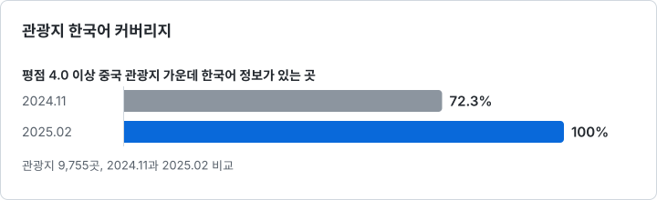
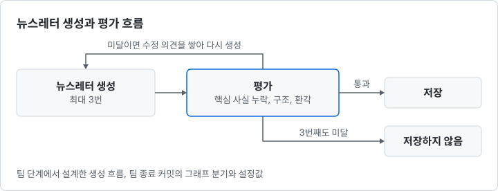
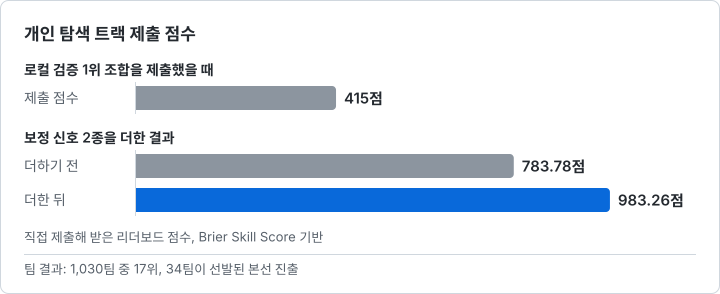
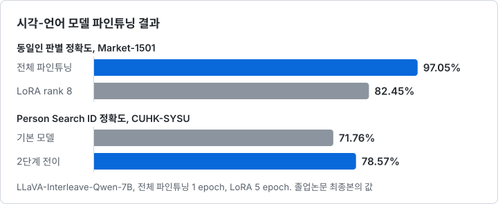

[한국어](./README.md) | [English](./README.en.md)

# 김형준 — AI Engineer

[LinkedIn](https://www.linkedin.com/in/heung-jun-kim-46652031a) | [GitHub](https://github.com/khj1212k)

기준을 먼저 세우고 LLM의 결과를 그 기준으로 검증하는 신입 AI 엔지니어입니다.

Trip.com 인턴으로 LLM 번역 파이프라인을, 5인 팀 팀장으로 LangGraph 뉴스레터 생성과 평가 파이프라인을 만들었고, 졸업논문에서 7B 시각-언어 모델을 파인튜닝했습니다.

AI 코딩 에이전트에 구현을 맡길 때도 방향과 검증 기준은 직접 정하고, 결과는 실제 조건에서 확인합니다.

---

## 프로젝트

### Trip.com LLM 번역 파이프라인 — 관광지 번역을 한 건씩 수작업으로 하고 있었다

> Trip.com Content Center | 인턴, 한국어 데이터 전담 | 2024.11 ~ 2025.02

**문제**: 관광지 한국어 번역을 내가 한 건씩 하고 있었다. 평점 4.0 이상 중국 관광지 가운데 한국어 정보가 있는 곳은 72.3%였다.

**해결**: LLM 번역 파이프라인 제작을 사내 문서로 제안. 5개 LLM을 같은 입력으로 비교해 모델 선택. 틀리면 여행자가 피해를 보는 필드부터 검수하는 기준과 프롬프트 틀 설계.

**결과**: 관광지 9,755곳의 한국어 커버리지 72.3%에서 100%. 프롬프트 틀과 검수 기준을 문서로 남겨 영어, 일본어, 태국어 담당자와 공유.

[상세 문서](./projects/tripcom-llm-translation.md) | 코드와 프롬프트 원문은 회사 자료라 비공개

### LangGraph 뉴스레터 생성 — 한 번에 쓰게 하면 사건이 섞이고 환각이 남았다

> 부스트캠프 AI Tech 8기 최종 프로젝트 | 5인 팀 팀장, 이후 개인 후속 작업 | 2026.01 ~ 2026.02

**문제**: 기사 묶음을 LLM에 넘겨 한 번에 쓰게 하면 서로 다른 사건이 한 편에 섞였다. 프롬프트를 다듬는 것만으로는 환각과 핵심 사실 누락을 매번 막을 수 없었다.

**해결**: 생성과 평가를 LangGraph 노드로 분리. 군집을 한 번 더 나누고 묶음이 한 사건인지 LLM이 먼저 판정. 팀 종료 뒤에는 Claude Code에 구현을 맡겨, 수치와 인용을 원문과 대조하는 검사 추가.

**결과**: 생성은 최대 3번, 끝내 평가를 통과하지 못한 초안은 저장하지 않는 흐름. 후속 단계의 원문 대조 검사는 수치를 바꾼 합성 변형 500건을 모두 검출.

[상세 문서](./projects/newsletter-langgraph.md) | [코드와 테스트](https://github.com/khj1212k/pro-recsys-finalproject-recsys-01) | [ADR 0010](https://github.com/khj1212k/pro-recsys-finalproject-recsys-01/blob/1a42b46c6efa93431e1dd0eb5fff0083ce14d914/docs/adr/0010-faithfulness-gate-and-judge-v2.md)

### LG Aimers 9기 해커톤 — 로컬 검증 1위 조합이 실제 제출에서 급락했다

> LG Aimers 9기 해커톤 | 5인 팀, GBDT 모델과 피처 담당 | 2026.08 ~ 2026.09

**문제**: 팀 작업과 별도로 AI 코딩 에이전트로 운영한 개인 탐색 트랙에서, 로컬 검증 1위 조합을 제출하자 점수가 415점으로 떨어졌다.

**해결**: 실험을 모두 멈추고 원인부터 정리하게 지시. 검증을 실제 제출 조건에 맞춰 에이전트와 다시 세우고, 통과한 버전만 직접 제출.

**결과**: 개인 탐색 트랙 783.78점에서 983.26점, 여기서 검증한 보정 신호 2종이 팀 최종 모델에 채택. 팀은 1,030팀 중 17위로, 34팀이 선발된 본선에 진출.

[상세 문서](./projects/lg-aimers-agent-validation.md) | [DACON 리더보드](https://dacon.io/competitions/official/236743/leaderboard) | 코드는 대회 규칙상 비공개

### 시각-언어 모델 행인 재식별 연구 — 재식별에 쓸 수 있는지 실험으로 확인해야 했다

> Fudan University 졸업논문 | 개인 연구 | 2025.03 ~ 2025.05

**문제**: 시각-언어 모델을 행인 재식별에 쓸 수 있는지는 실험으로 확인해야 했다. 7B 모델 전체를 학습하면 epoch당 2~3시간이 걸리는 제한된 GPU 환경이었다.

**해결**: 재식별을 이미지 쌍 질의응답으로 바꿔 LLaVA-Interleave-Qwen-7B를 파인튜닝. 전체 파인튜닝과 PEFT 3종을 총 학습 시간을 맞춰 비교. LoRA 가중치를 Person Search 학습의 초기값으로 이어 쓰는 2단계 전이 설계.

**결과**: 동일인 판별 정확도 97.05%(Market-1501), 2단계 전이로 Person Search ID 정확도 71.76%에서 78.57%. 같은 연구로 제1저자 학술대회 논문 2편.

[상세 문서](./projects/vlm-person-reid-thesis.md) | [학습 스크립트 fork](https://github.com/khj1212k/lmms-finetune)

---

## AI 코딩 에이전트를 쓰는 방식

**맡긴 것**: 뉴스레터 개인 후속 단계의 코드, 테스트, 설계 결정 기록. LG Aimers 개인 탐색 트랙의 실험 설계와 구현, 원인 보고서, 제출 패키지 감사. 도구는 Claude Code, opencode, Codex.

**내가 정한 것**: 방향과 검증 기준, 제출과 중단, 결과를 받아들일지. 1,100점이 비현실적이라는 에이전트의 판단은 리더보드로 반박했고, 산출 코드가 남지 않은 수치는 철회.

**확인한 수단**: 실제 리더보드 제출 점수, 푸시마다 도는 CI 테스트, 가짜 LLM으로 LangGraph 전체를 돌리는 테스트, 합성 변형 측정.

사례별로 나눠 한 일은 뉴스레터와 LG Aimers 상세 문서의 'AI 코딩 에이전트를 쓴 부분'에 적었습니다.

---

## 기타 경험

<b>학술대회 논문 2편</b> — 제1저자 | 2025

- Kim, H. J., et al. (2025). "A Study of Person Re-identification Based on Vision-Language Multimodal Large Language Model." 31st International Conference on IT Applications and Management (ITAM-31), 논문집 pp. 252-259.
- Kim, H. J., et al. (2025). "A Cost-Effective Training Method for Large Models in Pedestrian Search Task." 20th CCF Conference on Computer Supported Cooperative Work and Social Computing (ChineseCSCW 2025).
- 두 편 모두 졸업논문 연구를 정리한 논문

<b>학력과 교육</b> — Fudan University 학사, LG Aimers 9기, 부스트캠프 AI Tech 8기

- Fudan University, Information Management and Information Systems 학사 (2017.09 ~ 2025.06)
- LG Aimers 9기 수료 (LG AI연구원, 2026.06 ~ 2026.09)
- 부스트캠프 AI Tech 8기 RecSys 트랙 수료 (네이버 커넥트재단, 2025.09 ~ 2026.02)
- 언어: 한국어, 중국어(HSK 6급), 영어

<b>VisuAI</b> — 시각장애인 보행 보조 웹앱, 3인 팀 | 2022.12 ~ 2023.01

- 카메라로 찾은 장애물을 음성으로 알리는 웹앱
- 팀이 YOLOv5-nano를 파인튜닝하고 TensorFlow.js로 변환해 브라우저에서 동작
- [저장소](https://github.com/khj1212k/VisuAl_web)

---

## Technical Skills

| 영역 | 스택 |
| --- | --- |
| **Languages** | Python, SQL |
| **AI/ML** | PyTorch, Hugging Face Transformers, PEFT(LoRA, Prefix Tuning, Prompt Tuning), LangGraph, CatBoost |
| **AI 코딩 에이전트** | Claude Code, opencode, Codex |
| **Data** | Pandas, NumPy, Airflow |
| **Infra** | Git, GitHub, Linux, Docker |
| **연동만 한 것** | PostgreSQL(pgvector), FastAPI |

---

이 저장소의 글은 초안과 정리에 AI 도구를 썼고, 글과 그림의 저작권은 작성자에게 있습니다.
