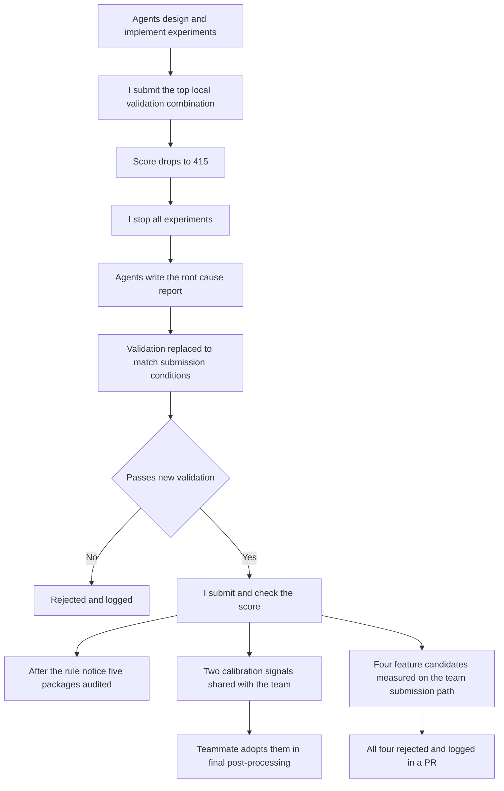

[한국어](./lg-aimers-agent-validation.md) | [English](./lg-aimers-agent-validation.en.md)

# After the top local-validation combination dropped to 415 points on submission, I rebuilt validation to match real submission conditions and raised my exploration track from 783.78 to 983.26 points

> In the LG Aimers 9th hackathon I delegated experiment design and implementation on my personal exploration track to AI coding agents and kept the submission thresholds and the stop decisions myself; two calibration signals verified there by real submissions were adopted in the team's final model.

## Overview

| Item | Details |
| --- | --- |
| Period | Aug 2026 to Sep 2026 (online Phase 2, then the offline final, Phase 3, on 19 and 20 Sep 2026) |
| Type | Team project. LG Aimers 9th hackathon (LG AI Research, operated on DACON), predicting the success probability of pitch command |
| Team and my role | 5-person team; GBDT models and features. Alongside the team work, ran a personal exploration track with AI coding agents |
| Tech | Python, Pandas, NumPy, CatBoost (used throughout feature engineering to find useful features), TabPFN (an experiment to check whether it could be applied), season-level walk-forward time-series cross-validation, AI coding agents (Claude Code, opencode, Codex) |
| Headline result | Personal exploration track leaderboard score improved from 783.78 to 983.26 (experiments implemented by AI coding agents; submission thresholds and stop decisions were mine); two calibration signals adopted in the post-processing calibration of the team's final model. Team result: 17th of 1,030 teams in Phase 2, advancing to the final of 34 selected teams |

## Problem

The task was to predict, for each pitch, the probability of command success from tabular data on baseball pitches and pitcher appearance history. Scores were based on the Brier Skill Score, and the evaluation data was the following season, which the training data did not cover.

On a 5-person team I was responsible for GBDT models and features, and alongside the team work I ran a personal exploration track with AI coding agents. On that track, changes that improved local validation kept lowering the score on actual submission, and the best score stayed at 783.78. The agents estimated that sampling variation alone produced a standard deviation of about 42 points on a validation fold of roughly 300,000 rows, while most of the gains being chased were 15 to 25 points, inside that range.

## What I did and why

The diagram shows the sequence from the drop to 415 points through to sharing with the team. Agents did the experiment design and implementation, the root-cause analysis and the validation design. I decided what to submit, when to stop, and the bar for anything going into the team's code. Of three agent judgments, I rejected two (that 1,100 points was unrealistic, and the estimated overlap with team code) and accepted one as it was, which scored 415.

### 1. I used the leaderboard to rebut the agent's judgment that 1,100 points was unrealistic

While the score sat in the 700s, the agent called the 1,100-point target unrealistic and kept repeating parameter tuning. I did not accept that, because many teams on the leaderboard were already above 1,000. If other teams had reached that score, we had simply not found the method yet. So I had the tuning loop stopped and had the agents go back to the data and the baseball domain to look for features. The cost was a much larger pool of feature candidates, each of which had to be screened by local validation.

### 2. When the top local-validation combination dropped to 415 points, I stopped every experiment and had the cause written up first

I submitted the combination the agent recommended as the best in local validation, and the score dropped to 415. Its key feature had shown the largest validation gain up to then and had passed the agent's leakage checks. I took that validation score at face value and decided to submit. 415 was the lowest score of any submission so far, so I stopped all experiments and had the results up to that point written up as a report.

The agent's analysis traced the cause to the validation method. During validation, a feature reflecting recent performance kept being updated with the outcomes of earlier pitches inside the validation season. The real evaluation was a new season in which those outcomes are unknown, so the feature lost its meaning once the season changed. Information from the evaluation period had leaked into the feature and inflated only the validation score. Stopping meant discarding the combination with the highest validation score and halting the follow-up experiments that were being prepared.

### 3. I rebuilt validation with the agents to match real submission conditions and submitted only versions that passed

With the agents, I rebuilt validation so that it used only information available at real submission time. This was the approach the agent's root-cause report had proposed as the next step. Records were frozen at the end of the previous season, and settings chosen on one season were applied unchanged to the next season to measure the score. A change counted as an improvement only if the score measured this way rose by more than about 42 points in both validation seasons.

I submitted only versions that passed this validation and checked their scores myself. The version with a season-boundary correction scored 960.18, and the version that added a renewal signal built from appearance history scored 983.26. The recent-performance features that had shown the largest gain under the old validation were left out. When a combination containing them was later re-measured under the new validation, it lost in both seasons.

### 4. After the rule-violation notice, I put a row-independence audit of five submission packages ahead of performance work

The organizers announced that rule violations were increasing. A prediction for one evaluation row that referred to other evaluation rows could lead to disqualification. A higher score is unusable if it breaks the rules, so I decided that the submission packages already built had to be checked before any more performance work. I gave the agent the text of the notice and had it audit five submission packages for row independence. The audit compared predictions when the official sample rows were fed one at a time, all together, in shuffled order, and with unrelated rows added, and all five packages passed. Performance work resumed only after I confirmed that, and directions that carry information between evaluation rows were dropped from the candidate list.

### 5. I set the bar that only measured gains on the team's submission path go into team code, and rejected four candidates

The personal track scored lower than the team's model. The agent's estimate was that the personal track's techniques overlapped with the team's code. Instead of relying on the estimate, I had the two compared directly and set the bar that a candidate missing from the team's code goes in only if it shows a gain when measured on the team's submission path. Four feature candidates lost in both validation periods and were not merged, and the results were recorded in a PR so the same experiments would not be repeated. No feature entered the team's code from this review.

The two calibration signals verified by real submissions were shared with the team as a design document and a notebook, and a teammate adopted them as inputs to the final model's post-processing probability calibration.

## Results and verification

| What | Value | Condition |
| --- | --- | --- |
| Best personal-track score before validation was fixed | 783.78 | Competition leaderboard score on submission (based on the Brier Skill Score) |
| Top local-validation combination | 415.04 | Same leaderboard; the combination recommended by the agent, as submitted |
| Season-boundary correction version | 960.18 | Same leaderboard; submitted after passing the new validation |
| Version with the renewal signal added | 983.26 | Same leaderboard; the version above plus a signal built from appearance history. Best personal-track score |
| Row-independence audit | All 5 passed | Five personal-track submission packages, after the rule-violation notice, compared on the official sample rows |
| Feature candidates for the team | All 4 rejected | Measured on the team's submission path; a loss in both validation periods |
| Calibration signals | 2 adopted | Post-processing probability calibration of the team's final submitted model |
| Team result, Phase 2 online | 17th of 1,030 teams, 1,184.98 points | Team's final submission, public DACON leaderboard |
| Team result, reaching the final | 34 teams selected | Phase 3 offline final (19 and 20 Sep 2026) |

All four personal-track scores are scores I received by submitting to the same competition leaderboard. The team's rank and score can be checked on the public DACON leaderboard. The audit and rejection results are kept in reports written by the agents, and I confirmed each pass and each rejection.

## My scope and the team's scope

What I owned

- GBDT models and features
- Running the personal exploration track: delegating experiments to agents and deciding the submission threshold score and whether each track continued or stopped
- Verifying the season-boundary correction and the renewal signal by real submissions, and sharing the design document and notebook, written with agents, with the team
- Handing over two sets of predictions and the inference code for the team merge (extraction and the match check were done by an agent)
- The decision to run the row-independence audit before performance work, and confirming that it passed
- The six EDA and feature slides of the final presentation (written with agents, then corrected against the final submission notebook)

What teammates owned

- The composition and blending of the team's final submitted model, and the team's final submission. The 17th place among 1,030 teams and the place in the final are team results obtained with this model
- The merge specification, and the decision to adopt the two calibration signals in the final model's post-processing

## Where AI coding agents were used

On the personal exploration track I split the work into tracks and gave them to Claude Code and opencode to run in parallel. In the final, I set up a structure in which a root agent assigned experiments, validation and submission to Codex workers.

| Work | What the agents did | What I decided and checked |
| --- | --- | --- |
| Personal exploration track experiments | Experiment design and implementation per track, local validation, result reports | Submission threshold score, continuing or stopping each track, the actual submissions and score checks |
| Direction of exploration | The judgment that the 1,100-point target was unrealistic; repeated parameter tuning | Rebuttal based on the leaderboard; the demand for domain-based feature discovery |
| The drop to 415 | Recommending the top local-validation combination and running the leakage checks; after the stop, the results report and root-cause analysis | The decision to submit, stopping all experiments, ordering the report |
| Rebuilding validation | Proposing, designing and implementing validation on frozen records; the threshold of about 42 points; implementing the calibration signals | Making a pass on the new validation the condition for submission; submitting only versions that passed and checking their scores |
| Rule compliance | The row-independence audit of five submission packages, working from the text of the notice | The decision to audit before performance work; confirming the pass |
| Sharing with the team | The comparison with team code, measuring four candidates on the team's submission path, writing the design document and notebook, extracting two sets of predictions and the inference code, verifying they were bit-identical to the original predictions | The bar of merging only measured gains, rejecting the four candidates, the condition that saved outputs be used first with no retraining |
| Presentation | Writing the six EDA and feature slides | Having them checked against the final submission notebook and correcting outdated content such as the feature count and the success rate |
| Final | A root agent assigning experiments, validation and submission to Codex workers | Setting up that structure; judging the Player metric, where rankings separated, to be the bottleneck and reassigning agents to it |

The code, experiment logs, root-cause report, deliverables handed to the team and presentation slides of the personal exploration track were written by agents. Of the agents' judgments, I rejected the one that 1,100 points was unrealistic, had the estimated overlap with team code checked by comparison and measurement, and accepted the recommendation of the top local-validation combination as it was, which scored 415.

## Limitations

- The personal-track scores are the scores returned at submission, as kept in the experiment log. The public leaderboard shows only the team's final score and rank.
- The new validation did not fully predict real scores either. The renewal signal showed a minimum gain of +46.96 points across the two past validation seasons but +23.08 on actual submission, and those two seasons were also used while developing the signal's structure. Another version that passed the new validation and was submitted ended at practically the same score as the season-boundary correction version.
- The combination that scored 415 bundled several features, and their individual effects were not separated by submitting them on their own.
- The personal track's best score of 983.26 is below the team's final score of 1,184.98. The 17th place is the result of the team's final model.
- The final (Phase 3) used a different metric (Pitch 70%, Player 30%).

## What you can check

- [LG Aimers 9th Phase 2 online hackathon leaderboard (DACON, page in Korean)](https://dacon.io/competitions/official/236743/leaderboard): the 17th row of the overall ranking, final score 1,184.97753
- The code, experiment logs, and audit and rejection reports are private. Competition rules do not allow the competition data or source code to be shared outside the team, so this document consists only of prose and a redrawn diagram.
