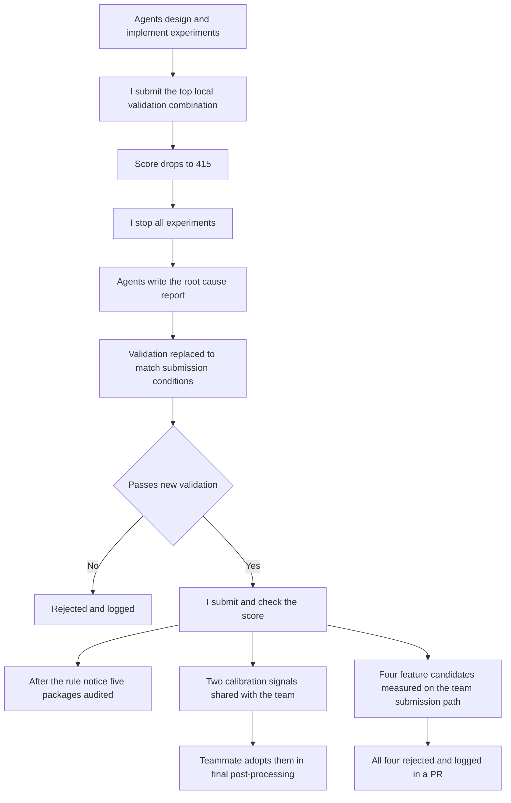

[한국어](./lg-aimers-agent-validation.md) | [English](./lg-aimers-agent-validation.en.md)

# LG Aimers 9th Hackathon — The top local-validation combination collapsed on real submission

> LG Aimers 9th hackathon | Five-person team; GBDT models and features | Aug to Sep 2026

The competition was to predict, for each pitch, the probability of successful pitch command from tabular baseball pitch and appearance-history data, and the evaluation data was the following season, which was not in the training data.

On the team I owned the GBDT models and features, and on a personal exploration track that I ran alongside the team work I delegated experiment design and implementation to AI coding agents and set the submission thresholds and the stop decisions myself.

I raised the personal exploration track from 783.78 to 983.26 points, and the team placed 17th of 1,030 teams and advanced to the final, for which 34 teams were selected.

---

## What I Did

The sequence from the drop to sharing with the team.

### 1. Direction of exploration — The agent judged 1,100 points to be unrealistic

**Problem**: With the score stuck in the 700s, the agent called the 1,100-point target unrealistic and kept repeating parameter tuning.

**Solution**: Rebutted the judgment on the grounds that many teams on the leaderboard were above 1,000 points. Stopped the tuning loop and had the agent go back to the data and the baseball domain to look for features.

**Result**: Feature candidates grew sharply, and the work moved to screening each one with local validation.

### 2. Stopping the experiments — The top local-validation combination dropped to 415 points

**Problem**: I trusted the combination the agent recommended as best in local validation and submitted it as it was. It had passed the leakage checks too, yet it scored lower than anything submitted before.

**Solution**: Stopped every experiment and had the results so far written up as a report.

**Result**: The agent's analysis traced the cause to the validation method. In validation, a feature built from recent performance kept being updated with the outcomes of earlier pitches inside the validation season; the real evaluation was a new season where those outcomes were unknown.

### 3. Rebuilding validation — Changes that helped in validation lowered the submitted score

**Problem**: Changes that improved local validation kept lowering the score on real submission. The gains being chased were mostly 15 to 25 points, inside the roughly 42-point standard deviation the agent estimated for sampling variation alone.

**Solution**: Rebuilt validation with the agents so that it uses only information available at real submission time. Froze the records up to the previous season and scored each season with settings fixed on the season before it. Submitted, myself, only versions that gained more than about 42 points in both validation seasons.

**Result**: Scored 960.18 with the season-boundary correction, and 983.26 after adding the renewal signal built from appearance history.

### 4. Row-independence audit — The organizers announced that rule violations were increasing

**Problem**: A prediction for one evaluation row that referred to other evaluation rows could mean disqualification. A higher score is unusable if it breaks the rules.

**Solution**: Decided to check the submission packages before any further performance work. Gave the agent the text of the notice and had it audit five submission packages for row independence. The audit compared predictions when the official sample rows were fed one at a time, all at once, in shuffled order, and with unrelated rows added.

**Result**: All five passed. Dropped any approach that carries information between evaluation rows.

### 5. Bar for team code — The agent assumed my track's techniques overlapped with the team's code

**Problem**: My track's score was below the team model's, and the agent assumed its techniques overlapped with the team's code.

**Solution**: Had the agent compare against the team's code directly instead of assuming. Set the bar that a candidate missing from the team's code goes in only if it shows a measured gain on the team's submission path.

**Result**: Rejected four feature candidates, which lost in both validation periods, and logged the result in a PR. A teammate adopted the two calibration signals verified by real submissions for the post-processing probability calibration of the final model.

---

## Results

| Item | Result | Conditions |
| --- | --- | --- |
| Personal exploration track | 783.78 to 983.26 points | Leaderboard scores from my own submissions; based on the Brier Skill Score |
| Row-independence audit | All five submission packages passed | After the rule-violation notice; compared on the official sample rows |
| Carried into the team model | Two calibration signals adopted, four feature candidates rejected | Adopted for post-processing calibration of the final model; rejected after measurement on the team's submission path |
| Team result | 17th of 1,030 teams; advanced to the final of 34 selected teams | Phase 2 online, public DACON leaderboard |

---

## More

<b>My scope and the team's</b>

- Mine: the GBDT models and features, running the personal exploration track, verifying the two calibration signals by real submission and sharing them with the team
- Handed to the team: two sets of predictions for the team merge with the inference code, and the six EDA and feature slides in the final presentation
- Teammates: composing and combining the team's final submitted model, deciding the merge specification, deciding to adopt the calibration signals
- The ranking and the place in the final are team results from the team's final model
- Tech: Python, Pandas, NumPy, CatBoost, season-level walk-forward time-series cross-validation. TabPFN was only checked for feasibility

<b>Where AI coding agents were used</b>

| Work | What the agents did | What I decided and checked |
| --- | --- | --- |
| Personal track experiments | Experiment design and implementation, local validation, result reports | Submission threshold, continue or stop, the actual submissions |
| The drop and the new validation | Recommending the combination, root-cause analysis, designing and implementing the new validation | Deciding to submit, stopping everything, making a pass on the new validation the condition for submission |
| Rule compliance | Row-independence audit of five submission packages | Auditing before performance work; confirming the pass |
| Sharing with the team | Comparison with team code, measuring four candidates, the design document and notebook, extracting the predictions | Merging only measured gains; rejecting the four |
| Presentation and final | Writing the six EDA and feature slides; experiments, validation and submission in the final | Having the slides checked against the final submission notebook; reassigning agents to the Player metric |

Of the agents' three judgments, I rejected two (that 1,100 points was unrealistic, and that my track overlapped with the team's code) and accepted the third, the top local-validation recommendation, as it was, which led to the drop. On the personal track I split the work between Claude Code and opencode; in the final I set up a root agent that assigned work to Codex workers.

<b>Limitations</b>

- Personal-track scores are the scores received on submission, as kept in my experiment log. The public leaderboard shows only the team's score and rank
- The new validation did not fully predict real scores either. The renewal signal gained at least +46.96 points in validation and +23.08 on real submission, and the two validation seasons had also been used to develop the signal
- The combination that dropped contained several features together, and their individual effects were not separated
- The best personal-track score is below the team's final score of 1,184.98 points
- The final used a different metric (Pitch 70%, Player 30%)

<b>What you can check</b>

- [DACON Phase 2 leaderboard](https://dacon.io/competitions/official/236743/leaderboard): the team's row, final score 1,184.97753
- Code, experiment logs, and the audit and rejection reports are private under competition rules. This page is prose and a redrawn diagram only

---
