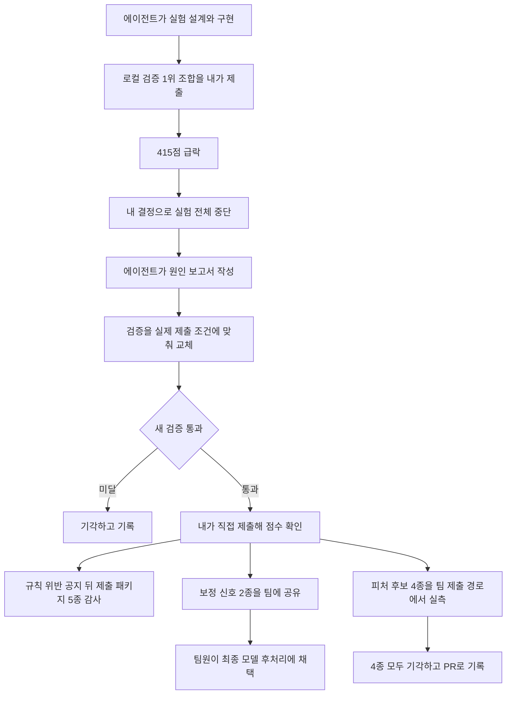

[한국어](./lg-aimers-agent-validation.md) | [English](./lg-aimers-agent-validation.en.md)

# LG Aimers 9기 해커톤 — 로컬 검증 1위 조합이 실제 제출에서 급락했다

> LG Aimers 9기 해커톤 | 5인 팀, GBDT 모델과 피처 담당 | 2026.08 ~ 2026.09

야구 투구와 등판 이력 정형 데이터로 투구마다 제구 성공 확률을 예측하는 대회였고, 평가 데이터는 학습 데이터에 없는 다음 시즌이었습니다.

팀에서 GBDT 모델과 피처를 맡으면서, 팀 작업과 따로 운영한 개인 탐색 트랙에서는 실험 설계와 구현을 AI 코딩 에이전트에 맡기고 제출 기준과 중단을 직접 정했습니다.

개인 탐색 트랙 점수를 783.78점에서 983.26점으로 올렸고, 팀은 1,030팀 중 17위로, 34팀이 선발된 본선에 진출했습니다.

---

## 한 일

급락부터 팀 공유까지의 순서입니다.

### 1. 탐색 방향 — 에이전트가 1,100점은 비현실적이라고 판단했다

**문제**: 점수가 700점대에 머물자 에이전트는 1,100점 목표가 비현실적이라며 파라미터 튜닝만 되풀이했다.

**해결**: 리더보드에 1,000점을 넘긴 팀이 많다는 점을 근거로 판단을 반박. 튜닝 반복을 멈추게 하고 데이터와 야구 도메인부터 다시 보며 피처를 찾게 지시.

**결과**: 피처 후보가 크게 늘었고, 후보마다 로컬 검증으로 가려내는 단계로 이동.

### 2. 실험 중단 — 로컬 검증 1위 조합이 415점으로 떨어졌다

**문제**: 에이전트가 로컬 검증에서 가장 좋다고 추천한 조합을 그대로 믿고 제출했다. 누수 점검도 통과한 조합이었지만 그때까지 제출한 점수 가운데 가장 낮은 점수를 받았다.

**해결**: 실험을 모두 멈추고 그때까지의 결과를 보고서로 정리하게 지시.

**결과**: 에이전트의 분석으로 드러난 원인은 검증 방식. 최근 성적을 반영한 피처가 검증에서는 검증 시즌 안의 앞선 투구 결과로 계속 갱신됐지만, 실제 평가는 새 시즌이라 그 결과를 알 수 없었음.

### 3. 검증 재수립 — 검증에서 좋아진 변경이 제출에서는 점수를 낮췄다

**문제**: 로컬 검증에서 좋아진 변경이 실제 제출에서는 점수를 낮추는 일이 되풀이됐다. 쫓던 개선 폭은 대부분 15~25점으로, 에이전트가 추정한 표본 차이의 점수 표준편차 약 42점 안에 있었다.

**해결**: 실제 제출 때 쓸 수 있는 정보만 쓰도록 검증을 에이전트와 재수립. 직전 시즌까지의 기록은 고정하고, 앞 시즌에서 정한 설정을 다음 시즌에 그대로 적용해 채점. 두 검증 시즌 모두 약 42점 넘게 오른 버전만 직접 제출.

**결과**: 시즌 경계 보정을 넣은 버전 960.18점, 등판 이력 기반 renewal 신호를 더한 버전 983.26점.

### 4. 행 독립성 감사 — 대회 측이 규칙 위반 사례가 늘었다고 공지했다

**문제**: 평가 행 하나의 예측에 다른 평가 행을 참조하면 실격될 수 있었다. 점수가 올라도 규칙을 어기면 쓸 수 없는 결과다.

**해결**: 성능 작업보다 제출 패키지 확인을 먼저 하기로 결정. 에이전트에 공지 원문을 주고 제출 패키지 5종의 행 독립성 감사를 지시. 공식 샘플 행을 하나씩, 한꺼번에, 순서를 섞어, 무관한 행을 더해 넣었을 때 예측이 같은지 비교.

**결과**: 5종 모두 통과. 평가 행끼리 정보를 이어 쓰는 방향은 후보에서 제외.

### 5. 팀 반영 기준 — 에이전트가 개인 트랙 기법이 팀 코드와 겹친다고 추정했다

**문제**: 개인 트랙 점수는 팀 모델보다 낮았고, 에이전트는 개인 트랙의 기법이 팀 코드와 겹친다고 추정했다.

**해결**: 추정 대신 팀 코드와 직접 대조하게 지시. 팀 코드에 없는 후보는 팀 제출 경로에서 재서 이득이 있을 때만 넣는다는 기준 수립.

**결과**: 피처 후보 4종은 두 검증 구간 모두 손해라 기각하고 결과를 PR로 기록. 실제 제출로 검증한 보정 신호 2종은 팀원이 최종 모델의 후처리 확률 보정에 채택.

---

## 결과

| 항목 | 결과 | 조건 |
| --- | --- | --- |
| 개인 탐색 트랙 | 783.78점에서 983.26점 | 직접 제출해 받은 리더보드 점수, Brier Skill Score 기반 |
| 행 독립성 감사 | 제출 패키지 5종 모두 통과 | 규칙 위반 공지 뒤, 공식 샘플 행으로 비교 |
| 팀 반영 | 보정 신호 2종 채택, 피처 후보 4종 기각 | 채택은 최종 모델의 후처리 확률 보정, 기각은 팀 제출 경로 실측 |
| 팀 결과 | 1,030팀 중 17위, 34팀이 선발된 본선 진출 | Phase 2 온라인, DACON 공개 리더보드 |

---

## 더 보기

<b>내 범위와 팀 범위</b>

- 내가 맡은 것: GBDT 모델과 피처, 개인 탐색 트랙 운영, 보정 신호 2종의 실제 제출 검증과 팀 공유
- 팀에 넘긴 것: 팀 병합용 예측 결과 2종과 추론 코드, 최종 발표자료의 EDA와 피처 파트 6장
- 팀원이 맡은 것: 팀 최종 제출 모델의 구성과 결합, 병합 사양 결정, 보정 신호의 채택 결정
- 순위와 본선 진출은 팀 최종 모델로 얻은 팀 결과
- 쓴 기술: Python, Pandas, NumPy, CatBoost, 시즌 단위 Walk-forward 시계열 교차검증. TabPFN은 적용 가능성만 검토

<b>AI 코딩 에이전트를 쓴 부분</b>

| 작업 | 에이전트가 한 것 | 내가 정하고 확인한 것 |
| --- | --- | --- |
| 개인 트랙 실험 | 실험 설계와 구현, 로컬 검증, 결과 보고 | 제출 기준 점수, 계속과 중단, 실제 제출 |
| 급락과 검증 재수립 | 조합 추천, 원인 분석, 새 검증의 설계와 구현 | 제출 결정, 전체 중단, 새 검증 통과를 제출 조건으로 |
| 규칙 준수 | 제출 패키지 5종의 행 독립성 감사 | 감사를 성능 작업보다 먼저, 통과 확인 |
| 팀 공유 | 팀 코드 대조, 후보 4종 측정, 설계 문서와 노트북, 예측 결과 추출 | 실측 이득이 있을 때만 반영, 4종 기각 |
| 발표자료와 본선 | EDA와 피처 6장 작성, 본선의 실험과 검증과 제출 | 최종 제출 노트북과 대조하게 해 정정, Player 지표로 에이전트 재배분 |

에이전트의 판단 셋 가운데 둘은 받아들이지 않았고(1,100점이 비현실적이라는 판단, 팀 코드와 겹친다는 추정), 로컬 검증 최고 조합 추천은 그대로 받아들였다가 급락을 겪었습니다. 개인 트랙은 Claude Code와 opencode에 트랙을 나눠 맡겼고, 본선에서는 루트 에이전트가 Codex 워커에 일을 나눠 맡기는 체계를 구성했습니다.

<b>한계</b>

- 개인 트랙 점수는 제출 때 받은 점수를 실험 기록에 남긴 값. 공개 리더보드에는 팀 점수와 순위만 있음
- 새 검증도 실제 점수를 다 맞히지는 못함. renewal 신호는 검증에서 최소 +46.96점, 실제 제출에서 +23.08점이고, 검증에 쓴 두 시즌은 신호를 개발할 때도 쓴 시즌
- 급락한 조합에는 여러 피처가 함께 들어 있었고, 피처별 영향은 따로 가려내지 못함
- 개인 트랙 최고점은 팀 최종 점수 1,184.98점보다 낮음
- 본선은 평가 지표가 달랐음(Pitch 70%, Player 30%)

<b>확인할 자료</b>

- [DACON Phase 2 리더보드](https://dacon.io/competitions/official/236743/leaderboard): 팀 순위 행, 최종 1,184.97753점
- 코드, 실험 기록, 감사와 기각 보고서는 대회 규칙상 비공개. 이 문서는 글과 다시 그린 그림으로만 구성

---
