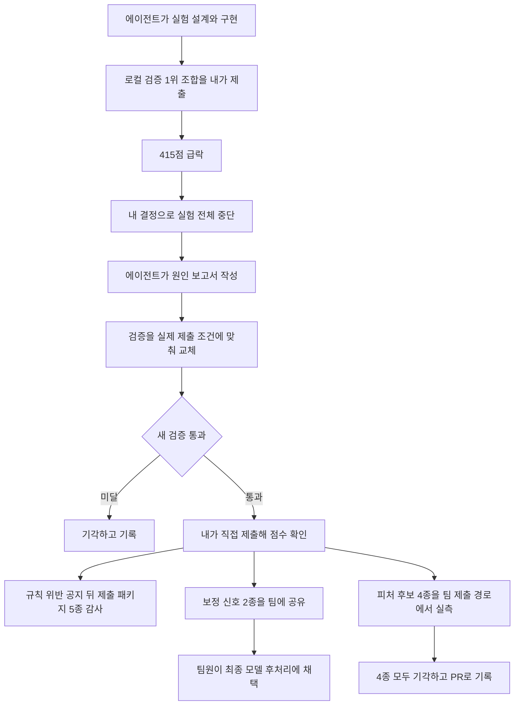

[한국어](./lg-aimers-agent-validation.md) | [English](./lg-aimers-agent-validation.en.md)

# 로컬 검증 1위 조합이 제출에서 415점으로 떨어진 뒤, 검증을 실제 제출 조건에 맞춰 다시 세워 개인 트랙 점수를 783.78점에서 983.26점으로 올렸습니다

> LG Aimers 9기 해커톤 개인 탐색 트랙에서 실험 설계와 구현은 AI 코딩 에이전트에 맡기고 제출 기준과 중단은 직접 정했으며, 여기서 실제 제출로 검증한 보정 신호 두 가지가 팀 최종 모델에 채택됐습니다.

## 개요

| 항목 | 내용 |
| --- | --- |
| 기간 | 2026.08 ~ 2026.09 (온라인 Phase 2, 이어서 2026.09.19 ~ 09.20 오프라인 본선 Phase 3) |
| 형태 | 팀 프로젝트. LG Aimers 9기 해커톤(LG AI연구원, 운영 DACON), 투구 제구 성공 확률 예측 |
| 팀과 내 역할 | 5인 팀, GBDT 모델과 피처 담당. 팀 작업과 별도로 AI 코딩 에이전트로 개인 탐색 트랙 운영 |
| 기술 | Python, Pandas, NumPy, CatBoost(좋은 피처를 찾는 피처 엔지니어링 내내 사용), TabPFN(적용 가능성을 검토한 실험), 시즌 단위 Walk-forward 시계열 교차검증, AI 코딩 에이전트(Claude Code, opencode, Codex) |
| 대표 결과 | 개인 탐색 트랙 리더보드 점수 783.78점에서 983.26점으로 개선(실험 구현은 AI 코딩 에이전트, 제출 기준과 중단은 직접), 보정 신호 2종이 팀 최종 모델의 후처리 보정에 채택. 팀 결과: Phase 2 1,030팀 중 17위, 34팀이 선발된 본선 진출 |

## 문제

야구 투구와 등판 이력 정형 데이터로 투구마다 제구 성공 확률을 예측하는 대회였습니다. 점수는 Brier Skill Score를 바탕으로 매겨졌고, 평가 데이터는 학습 데이터에 없는 다음 시즌이었습니다.

저는 5인 팀에서 GBDT 모델과 피처를 맡으면서, 팀 작업과 별도로 개인 탐색 트랙을 AI 코딩 에이전트로 운영했습니다. 이 트랙에서는 로컬 검증에서 좋아진 변경이 실제 제출에서는 점수를 낮추는 일이 되풀이됐고, 최고점은 783.78점에 머물렀습니다. 에이전트는 검증 구간 약 30만 행에서 표본 차이만으로 생기는 점수 표준편차를 약 42점으로 추정했는데, 그때까지 쫓던 개선 폭은 대부분 15~25점으로 이 폭 안에 있었습니다.

## 내가 한 일과 판단

아래는 415점 급락부터 팀 공유까지의 순서입니다. 실험 설계와 구현, 원인 분석, 검증 설계는 에이전트가 했고, 제출과 중단, 팀 반영 기준은 제가 정했습니다. 에이전트의 판단 셋 가운데 둘은 받아들이지 않았고(1,100점이 비현실적이라는 판단, 팀 코드와 겹친다는 추정), 하나는 그대로 받아 415점을 받았습니다.

### 1. 1,100점은 비현실적이라는 에이전트의 판단을 리더보드로 반박했습니다

점수가 700점대에 머물자 에이전트는 1,100점 목표가 비현실적이라며 파라미터 튜닝만 되풀이했습니다. 저는 리더보드에 1,000점을 넘긴 팀이 많다는 점을 근거로 이 판단을 받아들이지 않았습니다. 다른 팀이 도달한 점수라면 아직 방법을 못 찾은 것이라고 봤습니다. 그래서 튜닝 반복을 멈추게 하고 데이터와 야구 도메인부터 다시 보며 피처를 찾게 했습니다. 그 대신 피처 후보가 크게 늘었고, 후보마다 로컬 검증으로 가려내야 했습니다.

### 2. 로컬 검증 1위 조합이 415점으로 떨어지자 실험을 모두 멈추고 원인부터 정리하게 했습니다

에이전트가 로컬 검증에서 가장 좋다고 추천한 조합을 제출하자 점수가 415점으로 떨어졌습니다. 이 조합의 핵심 피처는 검증 개선폭이 그때까지 가장 컸고, 에이전트의 누수 점검도 통과한 상태였습니다. 저는 그 검증 점수를 그대로 믿고 제출을 정했습니다. 415점은 그때까지 제출한 점수 가운데 가장 낮았고, 저는 실험을 모두 멈추고 그때까지의 결과를 보고서로 정리하게 했습니다.

에이전트의 분석으로 드러난 원인은 검증 방식이었습니다. 최근 성적을 반영한 피처가 검증에서는 검증 시즌 안의 앞선 투구 결과로 계속 갱신됐습니다. 실제 평가는 새 시즌이라 그 결과를 알 수 없었고, 피처는 시즌이 바뀌며 의미를 잃었습니다. 평가 구간의 정보가 피처에 섞여 검증 점수만 높았던 것입니다. 이 중단으로 검증 점수가 가장 높았던 조합을 버렸고, 준비하던 후속 실험도 함께 멈췄습니다.

### 3. 검증을 실제 제출 조건에 맞춰 에이전트와 다시 세우고, 통과한 버전만 직접 제출했습니다

검증에는 실제 제출 때 쓸 수 있는 정보만 쓰도록 에이전트와 방식을 다시 세웠습니다. 에이전트의 원인 보고서가 다음 단계로 제안한 방식이었습니다. 직전 시즌까지의 기록은 고정하고, 앞 시즌에서 정한 설정을 다음 시즌에 그대로 적용해 점수를 쟀습니다. 개선 여부는 이렇게 잰 점수가 두 검증 시즌 모두 약 42점 넘게 오르는지로 판단했습니다.

저는 이 검증을 통과한 버전만 직접 제출해 점수를 확인했습니다. 시즌 경계 보정을 넣은 버전이 960.18점, 등판 이력 기반 renewal 신호를 더한 버전이 983.26점을 받았습니다. 이전 검증에서 개선폭이 가장 컸던 최근 성적 계열 피처는 쓰지 않았습니다. 이 피처를 담은 조합은 나중에 새 검증으로 다시 재자 두 시즌 모두 손해로 나왔습니다.

### 4. 규칙 위반 공지가 나오자 성능 작업보다 제출 패키지 5종의 행 독립성 감사를 먼저 했습니다

대회 측이 규칙 위반 사례가 늘었다고 공지했습니다. 평가 행 하나의 예측에 다른 평가 행을 참조하면 실격될 수 있었습니다. 점수가 올라도 규칙을 어기면 쓸 수 없는 결과이므로, 저는 성능 작업보다 이미 만든 제출 패키지부터 확인해야 한다고 판단했습니다. 에이전트에 공지 원문을 주고 제출 패키지 5종의 행 독립성 감사를 맡겼습니다. 감사는 공식 샘플 행을 하나씩 넣을 때, 한꺼번에 넣을 때, 순서를 섞을 때, 무관한 행을 더할 때 예측이 같은지 비교했고 5종 모두 통과했습니다. 통과를 확인한 뒤에 성능 작업을 이어 갔고, 평가 행끼리 정보를 이어 쓰는 방향은 후보에서 뺐습니다.

### 5. 팀 코드에는 팀 제출 경로에서 실측 이득이 있는 것만 넣기로 하고 후보 4종을 기각했습니다

개인 트랙 점수는 팀 모델보다 낮았습니다. 에이전트는 개인 트랙의 기법이 팀 코드와 겹친다고 추정했는데, 저는 추정 대신 팀 코드와 직접 대조하게 하고, 팀 코드에 없는 후보는 팀 제출 경로에서 재서 이득이 있을 때만 넣는다는 기준을 세웠습니다. 피처 후보 4종은 두 검증 구간 모두 손해로 나와 반영하지 않았고, 같은 실험이 되풀이되지 않도록 결과를 PR로 남겼습니다. 이 검토에서 팀 코드에 들어간 피처는 없었습니다.

실제 제출로 검증한 두 보정 신호는 설계 문서와 노트북으로 팀에 공유했고, 팀원이 최종 모델의 후처리 확률 보정 재료로 채택했습니다.

## 결과와 검증

| 무엇을 | 값 | 조건 |
| --- | --- | --- |
| 검증을 고치기 전 개인 트랙 최고점 | 783.78점 | 대회 리더보드 제출 점수(Brier Skill Score 기반) |
| 로컬 검증 1위 조합 | 415.04점 | 같은 리더보드, 에이전트가 추천한 조합을 제출한 결과 |
| 시즌 경계 보정 버전 | 960.18점 | 같은 리더보드, 새 검증을 통과한 뒤 제출 |
| renewal 신호를 더한 버전 | 983.26점 | 같은 리더보드, 위 버전에 등판 이력 기반 신호를 더해 제출. 개인 트랙 최고점 |
| 행 독립성 감사 | 5종 모두 통과 | 개인 트랙 제출 패키지 5종, 규칙 위반 공지 뒤, 공식 샘플 행으로 비교 |
| 팀 반영 후보 피처 | 4종 모두 기각 | 팀 제출 경로에서 측정, 두 검증 구간 모두 손해 |
| 보정 신호 | 2종 채택 | 팀 최종 제출 모델의 후처리 확률 보정 |
| 팀 결과, Phase 2 온라인 | 1,030팀 중 17위, 1,184.98점 | 팀 최종 제출, DACON 공개 리더보드 |
| 팀 결과, 본선 진출 | 34팀 선발 | Phase 3 오프라인 본선(2026.09.19 ~ 09.20) |

개인 트랙 점수 네 개는 모두 같은 대회 리더보드에 제가 제출해 받은 점수입니다. 팀 순위와 점수는 DACON 공개 리더보드에서 확인할 수 있습니다. 감사와 기각 결과는 에이전트가 쓴 보고서로 남겼고, 통과와 기각 판정은 제가 확인했습니다.

## 내 범위와 팀 범위

내가 맡은 것

- GBDT 모델과 피처
- 개인 탐색 트랙 운영: 에이전트에 실험을 맡기고 제출 기준 점수와 계속, 중단을 결정
- 시즌 경계 보정과 renewal 신호를 실제 제출로 검증하고, 에이전트로 작성한 설계 문서와 노트북을 팀에 공유
- 팀 병합용 예측 결과 2종과 추론 코드 전달(추출과 일치 검증은 에이전트)
- 행 독립성 감사를 성능 작업보다 먼저 하기로 한 결정과 통과 확인
- 최종 발표자료의 EDA와 피처 파트 6장 담당(에이전트로 작성, 최종 제출 노트북과 대조해 정정)

팀원이 맡은 것

- 팀 최종 제출 모델의 구성과 결합, 팀 최종 제출. 1,030팀 중 17위와 본선 진출은 이 모델로 얻은 팀 결과
- 병합 사양 결정, 두 보정 신호를 최종 모델의 후처리에 넣는 채택 결정

## AI 코딩 에이전트를 쓴 부분

개인 탐색 트랙에서는 Claude Code와 opencode에 트랙을 나눠 병렬로 실험을 맡겼고, 본선에서는 루트 에이전트가 Codex 워커에 실험, 검증, 제출을 나눠 맡기는 체계를 구성했습니다.

| 작업 | 에이전트가 한 것 | 내가 정하고 확인한 것 |
| --- | --- | --- |
| 개인 탐색 트랙 실험 | 트랙별 실험 설계와 구현, 로컬 검증, 결과 보고 | 제출 기준 점수, 트랙별 계속과 중단, 실제 제출과 점수 확인 |
| 탐색 방향 | 1,100점 목표는 비현실적이라는 판단, 파라미터 튜닝 반복 | 리더보드를 근거로 반박, 도메인 기반 피처 발굴 요구 |
| 415점 급락 | 로컬 검증 최고 조합 추천과 누수 점검, 중단 뒤 결과 보고서와 원인 분석 | 제출 결정, 실험 전체 중단, 보고서 작성 지시 |
| 검증 재수립 | 고정한 기록으로 재는 검증의 제안과 설계, 구현, 약 42점 문턱, 보정 신호 구현 | 새 검증 통과를 제출 조건으로 삼음, 통과한 버전만 직접 제출해 점수 확인 |
| 규칙 준수 | 공지 원문을 받아 제출 패키지 5종의 행 독립성 감사 | 감사를 성능 작업보다 먼저 한다는 결정, 통과 확인 |
| 팀 공유 | 팀 코드와의 대조, 후보 4종의 팀 제출 경로 측정, 설계 문서와 노트북 작성, 예측 결과 2종과 추론 코드 추출, 원래 예측과 비트 단위까지 같은지 검증 | 실측 이득이 있을 때만 반영한다는 기준, 4종 기각, 재학습 없이 저장된 결과부터 쓴다는 조건 |
| 발표자료 | EDA와 피처 파트 6장 작성 | 최종 제출 노트북과 대조하게 해 피처 수, 성공률 같은 예전 내용 정정 |
| 본선 | 루트 에이전트가 Codex 워커에 실험, 검증, 제출 배분 | 체계 구성, 순위가 갈리는 Player 지표를 병목으로 보고 에이전트 재배분 |

개인 탐색 트랙의 코드와 실험 기록, 원인 보고서, 팀에 넘긴 산출물, 발표자료는 에이전트가 작성했습니다. 에이전트의 판단 가운데 1,100점이 비현실적이라는 판단은 받아들이지 않았고, 팀 코드와 겹친다는 추정은 대조와 실측으로 확인하게 했으며, 로컬 검증 최고 조합 추천은 그대로 받아들였다가 415점을 받았습니다.

## 한계

- 개인 탐색 트랙의 점수는 제출 때 받은 점수를 실험 기록에 남긴 값이고, 공개 리더보드에서는 팀의 최종 점수와 순위만 확인할 수 있습니다.
- 새 검증도 실제 점수를 다 맞히지는 못했습니다. renewal 신호는 과거 두 시즌 검증에서 최소 +46.96점이었는데 실제 제출에서는 +23.08점이었고, 그 두 시즌은 신호 구조를 개발할 때도 쓴 시즌입니다. 새 검증을 통과해 제출한 다른 한 버전은 시즌 경계 보정 버전과 사실상 같은 점수에 그쳤습니다.
- 415점을 받은 조합에는 여러 피처가 함께 들어 있었고, 피처별 영향은 따로 제출해 가려내지 못했습니다.
- 개인 트랙 최고점 983.26점은 팀 최종 점수 1,184.98점보다 낮습니다. 17위는 팀 최종 모델의 결과입니다.
- 본선(Phase 3)은 평가 지표가 달랐습니다(Pitch 70%, Player 30%).

## 확인할 자료

- [LG Aimers 9기 Phase 2 온라인 해커톤 리더보드(DACON)](https://dacon.io/competitions/official/236743/leaderboard): 전체 랭킹 17위 행, 최종 점수 1,184.97753점
- 코드, 실험 기록, 감사와 기각 보고서는 비공개입니다. 대회 규칙상 대회 데이터와 소스코드를 팀 외부에 공유할 수 없어, 이 문서는 글과 다시 그린 그림으로만 구성했습니다.
