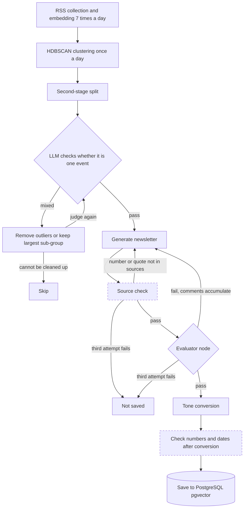

[한국어](./newsletter-langgraph.md) | [English](./newsletter-langgraph.en.md)

# Newsletter generation and evaluation split into separate LangGraph nodes; after the team project, a check that compares numbers and quotes with the sources, which the LLM judge could not see

> As leader of a five-person team I designed the LLM generation pipeline so that a draft that does not pass evaluation within three attempts is not saved. After the team project ended I continued alone on a fork, delegated implementation to an AI coding agent (Claude Code), set the direction and the verification criteria, and withdrew the figures I could not back up.

## Overview

| Item | Details |
| --- | --- |
| Period | Team phase: Jan 2026 to Feb 2026. Personal follow-up: a code review in Jul 2026, then ongoing work on the fork since Sep 2026 (this page reflects the commit of 2026-10-06) |
| Type | Team project (final project of the RecSys track, Boostcamp AI Tech 8th, NAVER Connect Foundation) and personal follow-up work on a fork of the team repository |
| Team and my role | Project leader of a 5-person team, about 30% contribution. Led the architecture and module interface design and owned the LLM generation pipeline. The follow-up is solo work with implementation delegated to Claude Code |
| Tech | Team phase: Python, LangGraph, HyperCLOVA X, BGE-M3, HDBSCAN, Airflow, PostgreSQL (pgvector). Follow-up: OpenAI-compatible LLM adapter (Gemini), Docker Compose, GitHub Actions, Claude Code |
| Headline results | Team phase: a generation flow capped at three attempts per article cluster, in which a draft that still fails is not saved. Follow-up (implemented by an AI coding agent): the source check caught all 500 cases where one number was scaled by 1.1 (excluding 15 cases where the changed value already appeared elsewhere) and wrongly blocked 0 of 494 numbers that were only rewritten in an equivalent notation (synthetic perturbations; the false-positive figure was re-measured on the same perturbation set after the fix) |

The code and the design decision records are on the [fork](https://github.com/khj1212k/pro-recsys-finalproject-recsys-01) (CI tests on every push, tests/, docs/adr/). Team-phase code runs up to commit `ef7c176`; everything after it is the personal follow-up.

## Problem

When many outlets report the same event, a reader has to go through several overlapping articles and piece the story together. The team set out to build a service that groups articles about one event, has an LLM write a single newsletter from them, and ranks the newsletters for each user.

Handing a group of articles to an LLM and asking for one pass broke down in two places. Embedding clusters mixed different events, so one newsletter ended up covering several topics. And prompt tuning alone could not stop hallucinations and missing key facts every time.

Problems remained after the team project ended. The LLM that judged drafts saw only the titles of the source articles, and some of the figures I had written into the team README had no code in the repository that produced them.

## What I did and why

Items 1 to 3 are decisions I made during the team phase. Items 4 and 5 belong to the personal follow-up after the final team commit `ef7c176` (2026-02-10); an AI coding agent implemented them and researched the design options.

Solid boxes are the flow designed in the team phase; the two dashed boxes are checks added in the follow-up. The evaluator's fail branch is the team-phase behaviour. Under the follow-up's default settings the evaluator only records its scores.

### 1. [Team phase] Generation and evaluation run in separate nodes, and a draft that fails three attempts is not saved

I judged that prompt edits alone could not stop hallucinations and omissions every time, so I separated the node that writes from the node that judges. The evaluator scores each draft from 0 to 10 on missing key facts, structure and hallucination, and passes only 5 or above. When a draft fails, the evaluator's revision comments are accumulated across attempts and passed to the next generation. To limit cost and latency I capped generation at three attempts per article cluster; if the third draft also fails, nothing is saved. Each saved newsletter keeps the per-attempt scores and comments, so it is possible to trace which draft was rejected and why.

The cost: a cluster that does not pass within three attempts produces no newsletter that day.

### 2. [Team phase] Clusters are split a second time, and an LLM first checks whether a cluster is one event

The first-pass clusters, HDBSCAN over BGE-M3 embeddings, mixed different events. I added two steps so that each newsletter covers one event. The first is a second-stage split: a cluster of four or more articles is tentatively split in two, and the Silhouette Score, the overlap of named entities in the titles and the share of duplicate titles together decide whether the split is kept. The second is the first judging node in LangGraph, where an LLM decides whether the cluster converges on a single issue. If it finds unrelated articles, the flow removes the outliers or keeps only the largest sub-group and judges again. A cluster that cannot be cleaned up, or that drops below three articles, is skipped.

Because only the largest sub-group is kept, the other sub-groups do not become newsletters in that run.

### 3. [Team phase] Collection runs seven times a day and clustering and generation once, and module inputs and outputs were agreed before implementation

Articles about one event come out over the course of a day. Clustering and writing on every collection run would split one event across several newsletters. So I divided the Airflow batch in two: collection, body extraction and embedding accumulate seven times a day, and clustering and generation run once a day over everything collected. With this structure, newsletters and recommendations refresh only once a day.

Five people owned different modules, so before implementation we agreed on data formats, APIs and database storage rules. When parse failures and rate-limit errors kept recurring because each module handled LLM responses differently, I had retries and parsing managed in one unified LLM client instead of patching each module. The retry added at that point had no upper bound; it was fixed in item 4.

### 4. [Personal follow-up] With implementation delegated to an agent, a check now compares numbers and quotes with the source articles, which the LLM judge could not see

The team-phase evaluator judged from at most five source titles, so it could not tell when a number or a quote was absent from the sources. The pass mark of 5 had never been compared with human judgment, and the tone-converted text that users actually see was not checked at all. Generation was capped at three attempts, but three retry paths underneath that cap had no bound.

I set the direction, which was to work on the AI part first, and required design decisions to be recorded as ADRs. The agent added four things.

- Source check: compares the numbers and quotations in a draft with the full text of every article in the cluster, and has the draft rewritten when something is not in the sources. ADR 0010 compared a judge-only approach and an NLI-model approach and chose this rule-based check: it costs nothing per call, it is reproducible, and it can name the wrong value.
- Post-conversion check: after tone conversion, looks for changed numbers and dates; if the change survives one re-conversion, the pre-conversion draft is saved.
- New evaluator node: reads article excerpts. It has not been calibrated against human labels, so a scored fail is only recorded and the draft passes, while a failed evaluation blocks publication.
- Retry bounds: the three retry paths that had no bound now have one, and tests check that each stops at its bound.

A number that is correct but does not appear literally in the sources, such as a computed total, is blocked too, which costs regenerations and published volume.

### 5. [Personal follow-up] Numbers I could not back up were withdrawn, and the README separates what was measured from what was not

The recommendation response time and source diversity figures that I had written into the team README had no code in the repository that produced them, so I removed them. The agent re-evaluated the team's recommendation metric on the synthetic click archive the team left behind. Once inference was moved to a point before the answer window, so that clicks from the answer period could not leak into the recommendation, the metric dropped sharply, and I decided not to use it either.

To keep the same thing from happening on the LLM side, the metrics and the decision rule for the model comparison were committed as a pre-registration document while no results existed (ADR 0009). The primary metric is a human judgment of whether a newsletter is publishable. The README lists what has been measured, what has not been measured yet, and what was withdrawn.

The cost: I can no longer present the team-phase outcome with numbers.

## Results and verification

Table 1. Team-phase results.

| Result | Conditions and how it was checked |
| --- | --- |
| At most three generation attempts per article cluster; if the third also fails, nothing is saved | Graph branches and settings at the final team commit. The judge is an LLM score from 0 to 10, pass at 5 or above |
| Collection seven times a day, clustering and generation once a day | Schedules of the two Airflow DAGs at the final team commit. The generation DAG runs at 17:00, and that run starts again from collection |

In the team phase the LLM judged drafts against criteria we gave it, and a person read the results and adjusted the criteria and prompts little by little.

Table 2. Follow-up results (implemented by an AI coding agent).

| Result | Conditions and how it was checked |
| --- | --- |
| 500 of 500 cases where one number was scaled by 1.1 were caught | Excludes 15 cases where the changed value already appeared elsewhere |
| 0 false positives on 494 numbers rewritten only in an equivalent notation | 14 of 494 before the causes found by this measurement were fixed; re-measured on the same 494 after the fix, 0 of 494 |
| When a number absent from the sources keeps appearing, three generations are followed by zero saved newsletters | Graph-level test that runs the whole LangGraph flow with a fake LLM. Unit tests and pgvector integration tests run in CI on every push |
| Three unbounded retry paths in the team-phase code fixed | The cluster-check path whose retry counter never increased and the judge-response parse path whose retry limit was effectively unlimited ([Jul 2026 review](https://github.com/khj1212k/pro-recsys-finalproject-recsys-01/blob/1a42b46c6efa93431e1dd0eb5fff0083ce14d914/docs/fix-log-2026-07.md)), plus the 429 and 5xx retry loop in the unified LLM client (Sep 2026 audit, [commit `e962deb`](https://github.com/khj1212k/pro-recsys-finalproject-recsys-01/commit/e962deb18695d648c83679bb36b835688e7a3f93)). Tests check that all three stop at their bound |

The first two rows were measured on synthetic perturbations of 401 newsletters from the team archive. No source articles remained, so each newsletter served as its own source; these figures therefore measure robustness to notation differences, not the block rate on real generated drafts.

## My scope and the team's scope

| Area | Owner |
| --- | --- |
| Overall architecture, data flow, module interfaces | Led by me. Data formats, APIs and database storage rules were agreed by the team |
| LangGraph generation and evaluation flow | Me |
| RSS collection and body cleaning, BGE-M3 embedding, HDBSCAN clustering and second-stage split, newsletter writing, prompts and the unified LLM client | Me. The team README lists these areas under one teammate as well |
| Airflow batches, ERD design, planning | Shared between me and teammates |
| Recommendation model (LightGBM, MMR), FastAPI backend and database setup, frontend and synthetic dataset | Teammates |

The role table in the team README (reproduced at the bottom of this page) lists crawling, clustering, newsletter writing, LLM and prompt work under both me and one teammate. Items 1 to 3 on this page cover the parts of that work that I designed and committed. The service as a whole, including recommendation and the UI, is a team result. In the anonymous peer feedback received after the project, all four teammates named clear communication and three named leadership as my strengths.

I chose to continue on a fork of the team repository instead of starting a new one so that the team history stays intact. Everything up to the final team commit is team work and the 463 commits after it are the personal follow-up, so the boundary is visible in the Git history.

## Where AI coding agents were used

The follow-up (items 4 and 5) was implemented by Claude Code, an AI coding agent. That covers the code, tests and documents in the 463 commits after the final team commit; I set the direction and the verification criteria and decided whether to accept each result. What I did not accept: figures whose producing code no longer existed, and the recommendation metric that turned out to leak once re-evaluated. All of those commits are under my account, so the repository alone does not show the distinction, and I state it here. The July 2026 code review and its fix log of 26 entries (25 code changes) were also done with Claude Code, and in September four of those fixes were corrected and ported to the fork.

- What the agent did: implemented code and tests, researched and proposed design options, wrote the design decision records and reports
- What I decided: the direction (AI part first), continuing on the fork instead of a new repository, requiring design decisions to be recorded as ADRs, withdrawing numbers that could not be backed up, disclosing the use of agents
- How results were checked: CI tests on every push, a test that runs the whole graph with a fake LLM, and the synthetic perturbation measurement. Pre-registered decision rules have so far been applied only to the recommendation experiments

During the team phase, in January 2026, I had a coding agent (Codex) build a separate prototype of the same project and compared collection approaches. Items 1 to 3 describe the code committed under my account in the team repository.

## Limitations

- The service is not deployed. There are no real users and no real usage logs.
- There are no human-labelled measurements of newsletter quality, factual accuracy or cluster split quality. In the team phase the judge was an LLM, with no fixed evaluation set and no human-written references. The pre-registered LLM model comparison has not been run yet.
- The source check figures measure robustness to notation differences on synthetic perturbations; the block rate on real generated drafts has not been measured. The 0 of 494 false positives was re-measured on the same perturbation set in which the causes were found, so this figure cannot show whether the result would also be zero on notations the check has not seen. The check does not catch wrong dates or fabricated claims that contain no number, and under the default settings, where the evaluator only records, nothing blocks hallucinations other than numbers and quotes.
- In the follow-up the generation job is switched off in the schedule, and there is no record of an end-to-end run on real data on main. The graph-level tests use a fake LLM.
- The throughput and recommendation metrics written down in the team phase are not included here, because either nothing remains to show how they were produced or the evaluation method leaked. The thresholds of the second-stage split are hard-coded constants with no documented basis.

## What you can check

Team phase. Links are pinned to the final team commit `ef7c176`.

- [workflow/graph.py](https://github.com/khj1212k/pro-recsys-finalproject-recsys-01/blob/ef7c176c4f795aad0d70e1c63ebd026065f4cd1e/ai_workspace/workflow/graph.py): generation, evaluation and regeneration branches
- [workflow/nodes.py](https://github.com/khj1212k/pro-recsys-finalproject-recsys-01/blob/ef7c176c4f795aad0d70e1c63ebd026065f4cd1e/ai_workspace/workflow/nodes.py) and [workflow/evaluators.py](https://github.com/khj1212k/pro-recsys-finalproject-recsys-01/blob/ef7c176c4f795aad0d70e1c63ebd026065f4cd1e/ai_workspace/workflow/evaluators.py): accumulated revision comments, ending without saving once the cap is reached, judging criteria and judge input
- [core/clustering/split_v2.py](https://github.com/khj1212k/pro-recsys-finalproject-recsys-01/blob/ef7c176c4f795aad0d70e1c63ebd026065f4cd1e/ai_workspace/core/clustering/split_v2.py): second-stage split

Personal follow-up. Links are pinned to fork main commit `1a42b46` (2026-10-06). The linked documents are written in Korean.

- [ADR 0010](https://github.com/khj1212k/pro-recsys-finalproject-recsys-01/blob/1a42b46c6efa93431e1dd0eb5fff0083ce14d914/docs/adr/0010-faithfulness-gate-and-judge-v2.md): options, evidence and limits for the source check and the new evaluator. [Graph-level tests](https://github.com/khj1212k/pro-recsys-finalproject-recsys-01/blob/1a42b46c6efa93431e1dd0eb5fff0083ce14d914/tests/test_workflow_faithfulness_gates.py)
- [ADR 0009](https://github.com/khj1212k/pro-recsys-finalproject-recsys-01/blob/1a42b46c6efa93431e1dd0eb5fff0083ce14d914/docs/adr/0009-llm-eval-protocol-and-preregistered-decision-rule.md): pre-registered LLM evaluation rules
- [Re-evaluation report for the team recommendation metric](https://github.com/khj1212k/pro-recsys-finalproject-recsys-01/blob/1a42b46c6efa93431e1dd0eb5fff0083ce14d914/reports/recsys/team_repro_v2.md)
- Scale of the work: 463 commits after the final team commit, 19 design decision records (17 accepted, 2 proposed), 22 merged PRs ([commit history](https://github.com/khj1212k/pro-recsys-finalproject-recsys-01/commits/1a42b46c6efa93431e1dd0eb5fff0083ce14d914)). 2026-09-25 to 2026-10-06, as of fork main commit `1a42b46`; the counts cover the whole repository, including the recommendation work. CI passes on this commit.
- [Original team repository](https://github.com/boostcampaitech8/pro-recsys-finalproject-recsys-01)

Not public. The collected article bodies are copyrighted by their publishers, so they appear neither in the repository nor on this page. The synthetic click archive used to re-evaluate the team recommendation metric is kept outside the repository, and the report contains aggregate figures only. The peer feedback itself is anonymous and is not reproduced.

## Team

Translated from the team table in the fork README. Names are given as they appear there.

| Name | Areas | GitHub |
| --- | --- | --- |
| 김형준 (Heung Jun Kim) | LangGraph, clustering, planning, newsletter writing, crawling, ERD design, LLM, prompt engineering, Airflow | [@khj1212k](https://github.com/khj1212k) |
| 박소정 | Back end, Airflow, database setup, ERD design, planning | [@sojeong0202](https://github.com/sojeong0202) |
| 성승우 | Recommendation model, planning | [@sssseungu](https://github.com/sssseungu) |
| 이선진 | Front end, back end, planning, synthetic dataset generation, database setup, ERD design, prototype implementation | [@Seonjin-13](https://github.com/Seonjin-13) |
| 이효창 | Planning, crawling, clustering, newsletter writing, LLM, prompt engineering | [@hochang2](https://github.com/hochang2) |
