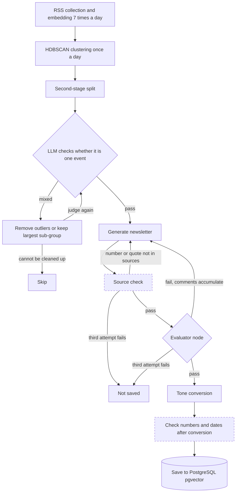

[한국어](./newsletter-langgraph.md) | [English](./newsletter-langgraph.en.md)

# LangGraph Newsletter Generation — One-pass drafts mixed separate events and still hallucinated

> Boostcamp AI Tech 8th final project | Leader of a five-person team, then solo follow-up | Jan to Feb 2026

The team built a service that groups articles about the same event, has an LLM write them up as one newsletter, and ranks the newsletters for each user.

As team leader I led the architecture and module interface design and owned the LLM generation pipeline; my contribution was about 30%.

I built a generation flow capped at three attempts, in which a draft that still fails evaluation is not saved, and after the team project I delegated implementation on a fork to an AI coding agent and added a check that compares numbers and quotes with the source articles.

---

## What I Did in the Team Phase

Solid boxes are the flow designed in the team phase; the two dashed boxes are checks added in the solo follow-up.

### 1. Separate generation and evaluation — Prompt edits alone did not stop hallucination or omissions

**Problem**: Prompt tuning alone could not reliably prevent hallucination or missing key facts.

**Solution**: Separated the writing node from the judging node in LangGraph. In the evaluator node an LLM (HyperCLOVA X) scores the draft from 0 to 10 on missing key facts, structure and hallucination, and only 5 or above passes. On a fail, the evaluator's comments accumulate across attempts and go into the next generation.

**Result**: To bound cost and latency, capped generation at three attempts per article cluster; if the third draft also fails, nothing is saved. Stored each saved newsletter with its per-attempt scores and comments.

### 2. Two-stage clustering — First-pass clusters mixed separate events

**Problem**: The first-pass clusters, built by grouping BGE-M3 embeddings with HDBSCAN, mixed separate events, so one newsletter covered several topics.

**Solution**: Tried splitting every cluster of four or more articles in two, then decided whether to keep the split from the Silhouette Score, the overlap of named entities in titles and the share of duplicate titles. In the first LangGraph judging node, an LLM checks whether the cluster is one event; if it is mixed, the outlying articles are removed or only the largest sub-group is kept, and the cluster is judged again.

**Result**: A flow that skips any cluster that cannot be cleaned up into one event or shrinks to fewer than three articles.

### 3. Batch schedule and interfaces — Clustering at every collection split one event into pieces

**Problem**: Articles about one event come out over the course of a day, so clustering at every collection splits one event across several newsletters. Each module also expected a different LLM response format, and parse failures and rate-limit errors kept recurring.

**Solution**: Split the Airflow batches in two: collection, body extraction and embedding run seven times a day, clustering and generation once. Agreed data formats, APIs and database storage rules with the team before implementation. Moved retries and parsing into a single unified LLM client.

**Result**: Two Airflow DAGs, one collecting seven times a day and one clustering and generating once a day. The retries added here had no upper bound; that was fixed in item 4.

---

## What I Did in the Solo Follow-up

This is the work after the final team commit `ef7c176` (2026-02-10), ongoing on the fork since September 2026. An AI coding agent, Claude Code, did the implementation and researched the design options; I set the direction and the verification criteria.

### 4. Source check — The LLM judge could not see the numbers and quotes in the sources

**Problem**: The team-phase evaluator judged from at most five source titles, so it could not tell when a number or quote was absent from the sources. The tone-converted version was never checked, and three retry paths beneath generation had no upper bound.

**Solution**: Added a rule-based check that compares the numbers and quotes in a draft with the full text of the cluster's articles and forces a rewrite when one is not in the sources. Chose it over an LLM-judge-only option and a natural language inference (NLI) model because it costs nothing, is reproducible and can point to the wrong value. Also added a check of numbers and dates after tone conversion and an upper bound on the three retry paths.

**Result**: Caught all 500 synthetic cases where one number was scaled by 1.1, with 0 false positives on 494 numbers rewritten only in an equivalent notation. A test that runs the whole graph with a fake LLM confirms that when a number absent from the sources keeps appearing, three generations end with nothing saved.

### 5. Withdrawn figures — The README carried numbers whose producing code no longer existed

**Problem**: The recommendation response time and source diversity figures I had written into the team README had no producing code in the repository.

**Solution**: Withdrew the figures I could not back up. Had the team's recommendation metrics re-evaluated on the synthetic click archive; once the inference time was moved earlier so that clicks from the answer period could not leak in, the metrics fell sharply, so they were left out as well. For the LLM model comparison, pre-registered the metrics and the decision rule before any result existed.

**Result**: The fork README now lists separately what was measured, what has not been measured yet and what was withdrawn.

---

## Results

| Item | Result | Conditions |
| --- | --- | --- |
| Generation flow, team phase | At most three attempts; a failing draft is not saved | Graph branches and settings at the final team commit |
| Batch schedule, team phase | Collection 7 times a day, clustering and generation once | Two Airflow DAGs at the final team commit |
| Source check, follow-up | 500 of 500 altered numbers caught; 0 of 494 false positives | Synthetic perturbations of 401 archived team newsletters |
| Retry bounds, follow-up | Three unbounded retry paths fixed | Tests check that all three stop at their bound |

---

## More

<b>My scope and the team's</b>

| Area | Owner |
| --- | --- |
| Overall architecture, data flow, module interfaces | Led by me; formats and storage rules agreed by the team |
| LangGraph generation and evaluation flow | Me |
| RSS collection and cleaning, embedding and clustering, newsletter writing and prompts, unified LLM client | Me; the team README lists one teammate as well |
| Airflow batches, ERD design, planning | Shared between me and teammates |
| Recommendation model, FastAPI backend and database, frontend, synthetic dataset | Teammates |

The service as a whole, including recommendation and the UI, is a team result. In the anonymous peer review, all four teammates named clear communication as a strength and three named leadership. Everything up to the final team commit is team work and the 463 commits after it are my solo follow-up, so the boundary is in the Git history.

<b>Where AI coding agents were used</b>

- What the agent did: the code, tests and documents in the 463 commits after the final team commit; researching and proposing design options; the July 2026 code review
- What I decided: the direction of putting the AI part first, continuing on the fork, having design decisions recorded as ADRs, withdrawing figures, and disclosing the use of an agent
- How I checked: CI tests on every push, a test that runs the whole graph with a fake LLM, synthetic perturbation measurement
- Technology added in the follow-up: an OpenAI-compatible LLM adapter (Gemini), Docker Compose, GitHub Actions
- Items 1 to 3 are based on code committed to the team repository under my account. In January 2026 I also built a separate prototype of the same task with Codex to compare collection approaches

Every commit is under my account, so the repository alone does not show the split. That is why it is stated here.

<b>Limitations</b>

- The service was never deployed. There are no real users and no usage logs
- The follow-up generation job is switched off in the schedule, and there is no record of a full run on real data on main
- No human-labeled measure of newsletter quality or cluster-split quality exists. In the team phase the judge was an LLM
- The source-check figures measure robustness to notation differences, not the blocking rate on real output
- The 500 caught cases exclude 15 where the changed value already appeared elsewhere. The 0 false positives were re-measured on the same 494 cases after the causes were fixed; before the fix there were 14
- The check also blocks numbers that are not literally in the sources, such as a computed total, and misses fabricated claims that contain no date or number
- The new evaluator node only records a fail, because it has not been calibrated against human labels. The pre-registered LLM model comparison has not been run yet
- A cluster that fails three attempts, and the articles outside the largest sub-group, produce no newsletter in that run
- Team-phase throughput and recommendation metrics are left out because their source is gone or the evaluation leaked. The second-stage split thresholds have no documented rationale either

<b>What you can check</b>

- [Fork repository](https://github.com/khj1212k/pro-recsys-finalproject-recsys-01): code, tests/, docs/adr/, CI tests on every push
- [workflow/graph.py](https://github.com/khj1212k/pro-recsys-finalproject-recsys-01/blob/ef7c176c4f795aad0d70e1c63ebd026065f4cd1e/ai_workspace/workflow/graph.py): team-phase generation, evaluation and regeneration branches
- [workflow/nodes.py](https://github.com/khj1212k/pro-recsys-finalproject-recsys-01/blob/ef7c176c4f795aad0d70e1c63ebd026065f4cd1e/ai_workspace/workflow/nodes.py), [workflow/evaluators.py](https://github.com/khj1212k/pro-recsys-finalproject-recsys-01/blob/ef7c176c4f795aad0d70e1c63ebd026065f4cd1e/ai_workspace/workflow/evaluators.py): accumulated comments, judging criteria
- [core/clustering/split_v2.py](https://github.com/khj1212k/pro-recsys-finalproject-recsys-01/blob/ef7c176c4f795aad0d70e1c63ebd026065f4cd1e/ai_workspace/core/clustering/split_v2.py): second-stage split
- [ADR 0010](https://github.com/khj1212k/pro-recsys-finalproject-recsys-01/blob/1a42b46c6efa93431e1dd0eb5fff0083ce14d914/docs/adr/0010-faithfulness-gate-and-judge-v2.md): options, evidence and limits of the source check
- [Graph-level tests](https://github.com/khj1212k/pro-recsys-finalproject-recsys-01/blob/1a42b46c6efa93431e1dd0eb5fff0083ce14d914/tests/test_workflow_faithfulness_gates.py): the whole LangGraph flow run with a fake LLM
- [ADR 0009](https://github.com/khj1212k/pro-recsys-finalproject-recsys-01/blob/1a42b46c6efa93431e1dd0eb5fff0083ce14d914/docs/adr/0009-llm-eval-protocol-and-preregistered-decision-rule.md): pre-registered LLM evaluation rule
- [Re-evaluation report on the team's recommendation metrics](https://github.com/khj1212k/pro-recsys-finalproject-recsys-01/blob/1a42b46c6efa93431e1dd0eb5fff0083ce14d914/reports/recsys/team_repro_v2.md): aggregate figures
- [July 2026 review log](https://github.com/khj1212k/pro-recsys-finalproject-recsys-01/blob/1a42b46c6efa93431e1dd0eb5fff0083ce14d914/docs/fix-log-2026-07.md), [commit `e962deb`](https://github.com/khj1212k/pro-recsys-finalproject-recsys-01/commit/e962deb18695d648c83679bb36b835688e7a3f93): retry bound fixes
- [Commit history](https://github.com/khj1212k/pro-recsys-finalproject-recsys-01/commits/1a42b46c6efa93431e1dd0eb5fff0083ce14d914): 463 commits after the final team commit, 19 design decision records, 22 merged PRs. These counts cover the whole repository, including the recommendation work
- [Original team repository](https://github.com/boostcampaitech8/pro-recsys-finalproject-recsys-01)

Team-phase links are pinned to the final team commit `ef7c176`, follow-up links to fork main commit `1a42b46` (2026-10-06), whose CI run passed. Article text, the synthetic click archive and the peer review responses are not included.

<b>Team</b>

| Name | Areas | GitHub |
| --- | --- | --- |
| 김형준 (Heung Jun Kim) | LangGraph, clustering, planning, newsletter writing, crawling, ERD design, LLM, prompt engineering, Airflow | [@khj1212k](https://github.com/khj1212k) |
| 박소정 | Back end, Airflow, database setup, ERD design, planning | [@sojeong0202](https://github.com/sojeong0202) |
| 성승우 | Recommendation model, planning | [@sssseungu](https://github.com/sssseungu) |
| 이선진 | Front end, back end, planning, synthetic dataset generation, database setup, ERD design, prototype implementation | [@Seonjin-13](https://github.com/Seonjin-13) |
| 이효창 | Planning, crawling, clustering, newsletter writing, LLM, prompt engineering | [@hochang2](https://github.com/hochang2) |

---
