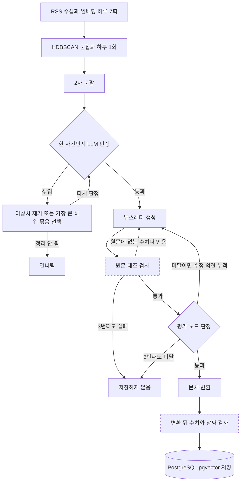

[한국어](./newsletter-langgraph.md) | [English](./newsletter-langgraph.en.md)

# LangGraph 뉴스레터 생성 — 한 번에 쓰게 하면 사건이 섞이고 환각이 남았다

> 부스트캠프 AI Tech 8기 최종 프로젝트 | 5인 팀 팀장, 이후 개인 후속 작업 | 2026.01 ~ 2026.02

같은 사건의 기사를 묶어 LLM이 뉴스레터 한 편으로 쓰고, 사용자별로 순위를 매겨 보여 주는 서비스를 팀이 만들었습니다.

팀장으로 전체 아키텍처와 모듈 인터페이스 설계를 주도하고 LLM 생성 파이프라인을 맡았으며, 기여도는 약 30%입니다.

생성은 최대 3번, 끝내 평가를 통과하지 못한 초안은 저장하지 않는 생성 흐름을 만들었고, 팀 종료 뒤에는 fork에서 구현을 AI 코딩 에이전트에 맡겨 수치와 인용을 원문과 대조하는 검사를 더했습니다.

---

## 팀 단계에서 한 일

실선 상자는 팀 단계에서 설계한 흐름이고, 점선 상자 둘은 개인 후속 단계에서 더한 검사입니다.

### 1. 생성과 평가 분리 — 프롬프트 수정만으로는 환각과 누락을 막지 못했다

**문제**: 프롬프트를 다듬는 것만으로는 환각과 핵심 사실 누락을 매번 막을 수 없었다.

**해결**: 쓰는 노드와 판정하는 노드를 LangGraph에서 분리. 평가 노드는 LLM(HyperCLOVA X)이 초안을 핵심 사실 누락, 구조, 환각 기준으로 0~10점으로 판정하고 5점 이상만 통과. 미달이면 수정 의견을 시도마다 쌓아 다음 생성에 전달.

**결과**: 비용과 지연을 제한하려고 생성은 기사 묶음 하나에 최대 3번, 세 번째 초안도 미달이면 저장하지 않음. 저장하는 뉴스레터에는 시도별 점수와 수정 의견을 함께 기록.

### 2. 2단계 군집 — 1차 군집에 서로 다른 사건이 섞였다

**문제**: BGE-M3 임베딩을 HDBSCAN으로 묶은 1차 군집에 서로 다른 사건이 섞여, 뉴스레터 한 편에 여러 주제가 들어갔다.

**해결**: 기사 4건 이상인 군집을 둘로 나눠 본 뒤 Silhouette Score, 제목 개체명의 겹침, 중복 제목 비율로 분할 여부 결정. LangGraph의 첫 판정 노드에서 한 사건인지 LLM이 판정하고, 섞였으면 벗어난 기사를 덜거나 가장 큰 하위 묶음만 남겨 다시 판정.

**결과**: 한 사건으로 정리되지 않거나 기사가 셋 미만으로 줄어든 묶음은 건너뛰는 흐름.

### 3. 배치 주기와 인터페이스 — 수집할 때마다 묶으면 한 사건이 쪼개졌다

**문제**: 같은 사건의 기사는 하루에 걸쳐 나뉘어 나와, 수집할 때마다 묶어 쓰면 한 사건이 여러 뉴스레터로 쪼개진다. 모듈마다 LLM 응답 형식이 달라 파싱 실패와 호출 한도 초과도 반복됐다.

**해결**: Airflow 배치를 둘로 나눠 수집, 본문 추출, 임베딩은 하루 7회 쌓고 군집화와 생성은 하루 1회 실행. 구현 전에 데이터 형식, API, DB 저장 기준을 팀과 합의. 통합 LLM 클라이언트 한 곳에서 재시도와 파싱 관리.

**결과**: 수집 하루 7회, 군집화와 생성 하루 1회로 도는 Airflow DAG 두 개. 이때 넣은 재시도에는 상한이 없었고 4번에서 수정.

---

## 개인 후속 단계에서 한 일

팀 종료 커밋 `ef7c176`(2026-02-10) 뒤의 작업으로, 2026.09부터 fork에서 진행 중입니다. 구현과 설계안 조사는 AI 코딩 에이전트인 Claude Code가 했고, 방향과 검증 기준은 직접 정했습니다.

### 4. 원문 대조 검사 — LLM 판정은 원문의 수치와 인용을 보지 못했다

**문제**: 팀 단계의 평가 노드는 원문 제목 최대 5건만 보고 판정해, 원문에 없는 수치나 인용을 가려낼 수 없었다. 문체 변환본은 검사를 거치지 않았고, 생성 아래층의 재시도 세 곳에는 상한이 없었다.

**해결**: 초안의 수치와 인용문을 기사 본문 전체와 대조해, 원문에 없으면 다시 쓰게 하는 규칙 기반 검사 추가. LLM 판정만 쓰는 안, 함의 판정(NLI) 모델을 쓰는 안과 비교해 비용이 들지 않고 재현되며 틀린 값을 짚어 주는 쪽을 선택. 문체 변환 뒤 검사와 재시도 상한도 추가.

**결과**: 수치 하나를 1.1배로 바꾼 합성 변형 500건을 모두 검출, 표기만 바꾼 494건의 오탐 0건. 원문에 없는 수치가 계속 나오면 생성 3회 뒤 저장 0건임을 가짜 LLM으로 그래프 전체를 돌리는 테스트로 확인.

### 5. 수치 철회 — 산출한 코드가 남지 않은 수치가 README에 있었다

**문제**: 팀 README를 정리하며 적은 추천 응답 시간과 소스 다양성 수치는 산출한 코드가 저장소에 없었다.

**해결**: 근거를 댈 수 없는 수치를 철회. 팀 추천 지표는 합성 클릭 아카이브로 다시 평가하게 했고, 정답 기간의 클릭이 섞이지 않게 추론 시점을 앞당기자 크게 내려가 함께 제외. LLM 모델 비교 평가는 결과가 없는 시점에 지표와 판정 규칙부터 사전 등록.

**결과**: fork README에 측정한 것, 아직 측정하지 않은 것, 철회한 것을 나눠 기재.

---

## 결과

| 항목 | 결과 | 조건 |
| --- | --- | --- |
| 생성 흐름, 팀 단계 | 생성 최대 3번, 미달이면 저장하지 않음 | 팀 종료 커밋의 그래프 분기와 설정값 |
| 배치 주기, 팀 단계 | 수집 하루 7회, 군집화와 생성 하루 1회 | 팀 종료 커밋의 Airflow DAG 두 개 |
| 원문 대조 검사, 후속 단계 | 수치 변형 500/500 검출, 표기 변형 오탐 0/494 | 팀 아카이브 뉴스레터 401편에 가한 합성 변형 |
| 재시도 상한, 후속 단계 | 상한 없던 3곳 수정 | 세 곳 모두 상한에서 멈추는지 테스트로 확인 |

---

## 더 보기

<b>내 범위와 팀 범위</b>

| 범위 | 담당 |
| --- | --- |
| 전체 아키텍처, 데이터 흐름, 모듈 인터페이스 | 본인 주도, 형식과 저장 기준은 팀 합의 |
| LangGraph 생성과 평가 흐름 | 본인 |
| RSS 수집과 정제, 임베딩과 군집화, 뉴스레터 제작과 프롬프트, 통합 LLM 클라이언트 | 본인, 팀 README에는 팀원 1명과 함께 표기 |
| Airflow 배치, ERD 설계, 기획 | 본인과 팀원 공동 |
| 추천 모델, FastAPI 백엔드와 DB, 프론트엔드, 합성 데이터셋 | 팀원 |

추천과 화면을 포함한 서비스 전체는 팀 결과입니다. 익명 동료 평가에서는 팀원 4명 모두 '명확한 커뮤니케이션'을, 3명이 '리더십'을 강점으로 꼽았습니다. 팀 종료 커밋까지가 팀 작업이고 그 뒤 커밋 463개가 개인 후속 작업이어서, 경계가 Git 이력에 남습니다.

<b>AI 코딩 에이전트를 쓴 부분</b>

- 에이전트가 한 일: 팀 종료 뒤 커밋 463개의 코드, 테스트, 문서. 설계 대안의 조사와 제안, 2026.07 코드 리뷰
- 내가 정한 것: AI 파트를 우선한다는 방향, fork에서 계속한다는 결정, 설계 결정을 기록(ADR)으로 남기게 한 것, 수치 철회, 에이전트 사용의 공개
- 확인한 수단: 푸시마다 도는 CI 테스트, 가짜 LLM으로 그래프 전체를 돌리는 테스트, 합성 변형 측정
- 후속 단계에서 더한 기술: OpenAI 호환 LLM 어댑터(Gemini), Docker Compose, GitHub Actions
- 팀 단계의 1~3번은 팀 저장소에 제 계정으로 커밋된 코드 기준. 2026년 1월에 같은 과제의 프로토타입을 Codex로 따로 만들어 수집 방식을 비교

커밋이 모두 제 계정으로 올라가 있어 저장소만으로는 구분되지 않으므로 여기에 밝힙니다.

<b>한계</b>

- 서비스는 배포되지 않았고 실사용자와 실사용 로그가 없음
- 후속 단계의 생성 잡은 스케줄에서 꺼 둔 상태. main에서 실데이터로 끝까지 돈 기록이 없음
- 뉴스레터 품질과 군집 분할 품질을 사람 라벨로 잰 수치가 없음. 팀 단계의 판정 주체는 LLM
- 원문 대조 검사의 수치는 표기 차이에 대한 강건성이고 실제 생성물의 차단율이 아님
- 검출 500건은 바꾼 값이 다른 곳에 이미 있던 15건 제외. 오탐 0건은 원인을 고친 뒤 같은 494건으로 다시 잰 값이고 고치기 전에는 14건
- 계산한 합계처럼 원문에 글자로 없는 수치도 막히고, 날짜와 수치 없는 지어낸 주장은 잡지 못함
- 새 평가 노드는 사람 라벨로 보정하기 전이라 미달을 기록만 함. 사전 등록한 LLM 모델 비교 평가는 아직 실행 전
- 3번 안에 통과하지 못한 묶음과 가장 큰 하위 묶음에서 빠진 기사는 그 실행에서 뉴스레터가 되지 않음
- 팀 단계의 처리량과 추천 지표는 근거가 남지 않았거나 누출이 있어 싣지 않음. 2차 분할의 임계값도 근거 문서가 없음

<b>확인할 자료</b>

- [fork 저장소](https://github.com/khj1212k/pro-recsys-finalproject-recsys-01): 코드, tests/, docs/adr/, 푸시마다 CI 테스트
- [workflow/graph.py](https://github.com/khj1212k/pro-recsys-finalproject-recsys-01/blob/ef7c176c4f795aad0d70e1c63ebd026065f4cd1e/ai_workspace/workflow/graph.py): 팀 단계의 생성, 평가, 재생성 분기
- [workflow/nodes.py](https://github.com/khj1212k/pro-recsys-finalproject-recsys-01/blob/ef7c176c4f795aad0d70e1c63ebd026065f4cd1e/ai_workspace/workflow/nodes.py), [workflow/evaluators.py](https://github.com/khj1212k/pro-recsys-finalproject-recsys-01/blob/ef7c176c4f795aad0d70e1c63ebd026065f4cd1e/ai_workspace/workflow/evaluators.py): 수정 의견 누적, 판정 기준
- [core/clustering/split_v2.py](https://github.com/khj1212k/pro-recsys-finalproject-recsys-01/blob/ef7c176c4f795aad0d70e1c63ebd026065f4cd1e/ai_workspace/core/clustering/split_v2.py): 2차 분할
- [ADR 0010](https://github.com/khj1212k/pro-recsys-finalproject-recsys-01/blob/1a42b46c6efa93431e1dd0eb5fff0083ce14d914/docs/adr/0010-faithfulness-gate-and-judge-v2.md): 원문 대조 검사의 대안, 증거, 한계
- [그래프 수준 테스트](https://github.com/khj1212k/pro-recsys-finalproject-recsys-01/blob/1a42b46c6efa93431e1dd0eb5fff0083ce14d914/tests/test_workflow_faithfulness_gates.py): 가짜 LLM으로 LangGraph 전체 실행
- [ADR 0009](https://github.com/khj1212k/pro-recsys-finalproject-recsys-01/blob/1a42b46c6efa93431e1dd0eb5fff0083ce14d914/docs/adr/0009-llm-eval-protocol-and-preregistered-decision-rule.md): 사전 등록한 LLM 평가 규칙
- [팀 추천 지표 재평가 보고서](https://github.com/khj1212k/pro-recsys-finalproject-recsys-01/blob/1a42b46c6efa93431e1dd0eb5fff0083ce14d914/reports/recsys/team_repro_v2.md): 집계 수치
- [2026.07 리뷰 기록](https://github.com/khj1212k/pro-recsys-finalproject-recsys-01/blob/1a42b46c6efa93431e1dd0eb5fff0083ce14d914/docs/fix-log-2026-07.md), [커밋 `e962deb`](https://github.com/khj1212k/pro-recsys-finalproject-recsys-01/commit/e962deb18695d648c83679bb36b835688e7a3f93): 재시도 상한 수정
- [커밋 이력](https://github.com/khj1212k/pro-recsys-finalproject-recsys-01/commits/1a42b46c6efa93431e1dd0eb5fff0083ce14d914): 팀 종료 뒤 커밋 463개, 설계 결정 기록 19건, 병합된 PR 22개. 추천 쪽 작업을 포함한 저장소 전체의 수
- [팀 원본 저장소](https://github.com/boostcampaitech8/pro-recsys-finalproject-recsys-01)

팀 단계 링크는 팀 종료 커밋 `ef7c176`에, 후속 단계 링크는 fork main 커밋 `1a42b46`(2026-10-06)에 고정했고, 이 커밋의 CI는 통과했습니다. 기사 본문, 합성 클릭 아카이브, 동료 평가 원문은 싣지 않습니다.

<b>팀</b>

| 이름 | 담당 영역 | GitHub |
| --- | --- | --- |
| 김형준 | LangGraph, Clustering, 기획, 뉴스레터 제작, Crawling, ERD 설계, LLM, Prompt Engineering, Airflow | [@khj1212k](https://github.com/khj1212k) |
| 박소정 | Back-End, Airflow, DB 구축, ERD 설계, 기획 | [@sojeong0202](https://github.com/sojeong0202) |
| 성승우 | 추천모델, 기획 | [@sssseungu](https://github.com/sssseungu) |
| 이선진 | Front-End, Back-End, 기획, 합성 데이터셋 생성, DB 구축, ERD 설계, 프로토타입 구현 | [@Seonjin-13](https://github.com/Seonjin-13) |
| 이효창 | 기획, Crawling, Clustering, 뉴스레터 제작, LLM, Prompt Engineering | [@hochang2](https://github.com/hochang2) |

---
