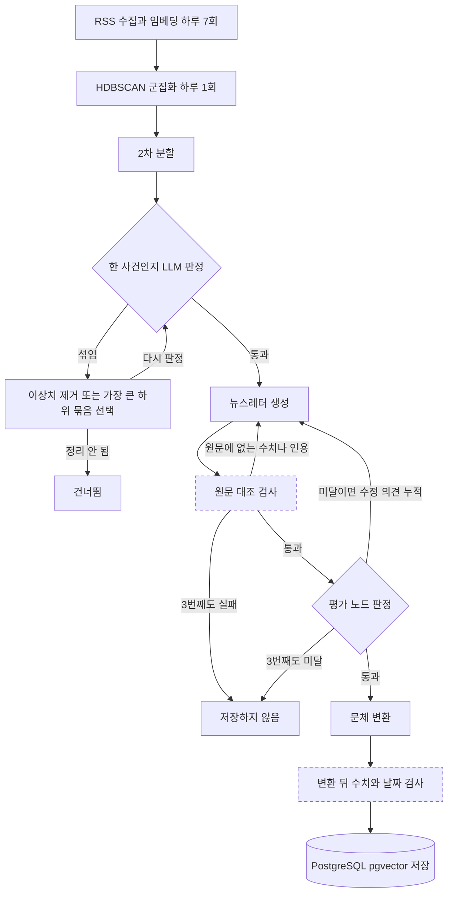

[한국어](./newsletter-langgraph.md) | [English](./newsletter-langgraph.en.md)

# 뉴스레터 생성과 평가를 LangGraph 노드로 나누고, 팀 종료 뒤에는 LLM 판정이 보지 못하던 수치와 인용을 원문과 대조하는 검사를 더했습니다

> 5인 팀의 팀장으로 LLM 생성 파이프라인을 설계해, 3번 안에 평가를 통과하지 못한 초안은 저장하지 않게 했습니다. 팀 프로젝트가 끝난 뒤에는 fork에서 혼자 이어 가며 구현을 AI 코딩 에이전트(Claude Code)에 맡기고, 방향과 검증 기준을 정했으며 근거를 댈 수 없는 수치는 철회했습니다.

## 개요

| 항목 | 내용 |
| --- | --- |
| 기간 | 팀 단계 2026.01 ~ 2026.02. 개인 후속 단계는 2026.07 코드 리뷰를 거쳐 2026.09부터 fork에서 진행 중(이 문서는 2026-10-06 커밋 기준) |
| 형태 | 팀 프로젝트(네이버 커넥트재단 부스트캠프 AI Tech 8기 RecSys 트랙 최종 프로젝트)와 그 저장소의 fork에서 이어 간 개인 후속 작업 |
| 팀과 내 역할 | 5인 팀의 팀장, 기여도 약 30%. 전체 아키텍처와 모듈 인터페이스 설계 주도, LLM 생성 파이프라인 담당. 개인 후속 단계는 1인 작업이며 구현은 Claude Code에 맡김 |
| 기술 | 팀 단계: Python, LangGraph, HyperCLOVA X, BGE-M3, HDBSCAN, Airflow, PostgreSQL(pgvector). 개인 후속 단계: OpenAI 호환 LLM 어댑터(Gemini), Docker Compose, GitHub Actions, Claude Code |
| 대표 결과 | 팀 단계: 기사 묶음 하나에 생성 최대 3번, 끝내 미달인 초안은 저장하지 않는 생성 흐름. 개인 후속 단계(구현은 AI 코딩 에이전트): 원문 대조 검사가 수치 하나를 1.1배로 바꾼 변형 500건을 모두 검출했고(바꾼 값이 다른 곳에 이미 있던 15건 제외), 표기만 바꾼 수치 494건을 잘못 막은 경우는 0건(합성 변형이며, 오탐은 같은 변형 세트로 고친 뒤 다시 잰 값) |

코드와 설계 결정 기록은 [fork](https://github.com/khj1212k/pro-recsys-finalproject-recsys-01)에 있습니다(푸시마다 CI 테스트, tests/, docs/adr/). 팀 단계 코드는 커밋 `ef7c176`까지이고 그 뒤는 개인 후속 작업입니다.

## 문제

여러 언론사가 같은 사건을 반복해 보도하면 독자는 겹치는 기사를 여러 편 읽고 스스로 정리해야 합니다. 팀은 같은 사건의 기사를 묶어 LLM이 뉴스레터 한 편으로 쓰고, 사용자별로 순위를 매겨 보여 주는 서비스를 만들기로 했습니다.

기사 묶음을 LLM에 넘겨 한 번에 쓰게 하는 방식은 두 곳에서 막혔습니다. 임베딩 군집에 서로 다른 사건이 섞여 뉴스레터 한 편에 여러 주제가 들어갔습니다. 프롬프트를 다듬는 것만으로는 환각과 핵심 사실 누락을 매번 막을 수 없었습니다.

팀 프로젝트가 끝난 뒤에도 문제가 남았습니다. 초안을 판정하는 LLM은 원문 기사의 제목만 보았고, 제가 팀 README를 정리하며 적은 수치 일부는 산출한 코드가 저장소에 없었습니다.

## 내가 한 일과 판단

1~3번은 팀 단계에서 제가 내린 판단입니다. 4~5번은 팀 종료 커밋 `ef7c176`(2026-02-10) 뒤의 개인 후속 단계이고, 구현과 설계안 조사는 AI 코딩 에이전트가 했습니다.

실선 상자는 팀 단계에서 설계한 흐름이고, 점선 상자 둘은 개인 후속 단계에서 더한 검사입니다. 평가 노드의 미달 분기는 팀 단계의 동작이며, 후속 단계의 기본 설정에서는 평가 노드가 채점 결과를 기록만 합니다.

### 1. [팀 단계] 생성과 평가를 다른 노드로 나누고, 3번 안에 통과하지 못한 초안은 저장하지 않았습니다

프롬프트 수정만으로는 환각과 누락을 매번 막을 수 없다고 보고, 쓰는 노드와 판정하는 노드를 나눴습니다. 평가 노드는 초안을 핵심 사실 누락, 구조, 환각 기준으로 0~10점으로 판정하고 5점 이상만 통과시킵니다. 미달이면 평가 노드의 수정 의견을 시도마다 쌓아 다음 생성에 넘깁니다. 비용과 지연을 제한하려고 생성은 기사 묶음 하나에 최대 3번까지만 하게 했고, 세 번째 초안도 미달이면 저장하지 않습니다. 저장하는 뉴스레터에는 시도별 점수와 수정 의견을 함께 남겨, 어느 초안이 왜 걸러졌는지 되짚을 수 있게 했습니다.

그 대가로 세 번 안에 통과하지 못한 묶음은 그날 뉴스레터가 나오지 않습니다.

### 2. [팀 단계] 군집을 한 번 더 나누고, 묶음이 한 사건인지 LLM이 먼저 판정하게 했습니다

BGE-M3 임베딩을 HDBSCAN으로 묶은 1차 군집에는 서로 다른 사건이 섞여 있었습니다. 뉴스레터 하나가 한 사건에 집중하도록 두 단계를 더했습니다. 먼저 2차 분할입니다. 기사 4건 이상인 군집을 둘로 나눠 본 뒤 Silhouette Score, 제목 개체명의 겹침, 중복 제목 비율을 함께 보고 실제로 나눌지 정합니다. 다음은 LangGraph의 첫 판정 노드입니다. 묶음이 하나의 이슈로 모이는지 LLM이 판정하고, 섞였다고 보면 벗어난 기사를 덜어 내거나 가장 큰 하위 묶음만 남겨 다시 판정합니다. 정리되지 않거나 기사가 셋 미만으로 줄면 그 묶음은 건너뜁니다.

하위 묶음 가운데 가장 큰 하나만 남기므로, 나머지 하위 묶음은 그 실행에서 뉴스레터가 되지 않습니다.

### 3. [팀 단계] 수집은 하루 7회, 군집화와 생성은 하루 1회로 나누고, 모듈 사이의 입출력을 구현 전에 합의했습니다

같은 사건의 기사는 하루에 걸쳐 나뉘어 나오므로, 수집할 때마다 묶어 쓰면 한 사건이 여러 뉴스레터로 쪼개집니다. 그래서 Airflow 배치를 둘로 나눠 수집, 본문 추출, 임베딩은 하루 7회 쌓고 군집화와 생성은 하루 1회 모아서 실행했습니다. 그 대가로 뉴스레터와 추천은 하루 한 번만 갱신됩니다.

다섯 명이 모듈을 나눠 맡았기 때문에 구현에 들어가기 전에 데이터 형식, API, DB 저장 기준을 먼저 합의했습니다. 모듈마다 LLM 응답 형식이 달라 파싱 실패와 호출 한도 초과가 반복됐을 때는, 각자 고치는 대신 통합 LLM 클라이언트 한 곳에서 재시도와 파싱을 관리하게 했습니다. 이때 넣은 재시도에는 상한이 없었고, 4번에서 고쳤습니다.

### 4. [개인 후속 단계] 구현을 에이전트에 맡겨, LLM 판정이 보지 못하던 수치와 인용을 원문과 대조하는 검사를 더했습니다

팀 단계의 평가 노드는 원문 제목 최대 5건만 보고 판정해, 원문에 없는 수치나 인용을 가려낼 수 없었습니다. 5점 기준은 사람의 판정과 대조해 본 적이 없었고, 사용자에게 보이는 문체 변환본은 검사를 거치지 않았습니다. 생성 횟수는 3번으로 제한했지만 그 아래층의 재시도 세 곳에는 상한이 없었습니다.

저는 AI 파트를 우선한다는 방향을 정하고, 설계 결정은 기록(ADR)으로 남기게 했습니다. 에이전트가 더한 것은 넷입니다.

- 원문 대조 검사: 초안의 수치와 인용문을 묶음의 기사 본문 전체와 대조해, 원문에 없으면 다시 쓰게 합니다. ADR 0010은 LLM 판정만 쓰는 안, 함의 판정(NLI) 모델을 쓰는 안과 비교해 이 규칙 기반 검사를 택했습니다. 비용이 들지 않고 재현되며, 틀린 값을 짚어 줄 수 있어서입니다.
- 변환 뒤 검사: 문체 변환 뒤에도 수치와 날짜가 바뀌었는지 보고, 한 번 다시 변환해도 남으면 변환 전 초안을 저장합니다.
- 새 평가 노드: 본문 발췌를 봅니다. 사람 라벨로 보정하기 전이어서 미달은 기록만 하고 통과시키며, 평가 자체가 실패하면 발행하지 않습니다.
- 재시도 상한: 상한이 없던 세 곳에 상한을 넣었고, 상한에서 멈추는지는 테스트가 확인합니다.

계산한 합계처럼 원문에 글자로 없는 수치도 막히므로, 재생성 비용과 발행량 손실이 따릅니다.

### 5. [개인 후속 단계] 근거를 댈 수 없는 수치는 철회하고, 측정한 것과 측정하지 않은 것을 README에 나눠 적었습니다

제가 팀 README를 정리하며 적은 추천 응답 시간과 소스 다양성 수치는 산출한 코드가 저장소에 없어 뺐습니다. 팀 추천 지표는 에이전트가 팀이 남긴 합성 클릭 아카이브로 다시 평가했습니다. 정답으로 쓸 기간의 클릭이 추천 계산에 섞이지 않게 추론 시점을 앞당기자 지표가 크게 내려갔고, 이 지표도 쓰지 않기로 했습니다.

같은 일이 LLM 쪽에서 되풀이되지 않도록, 모델 비교 평가는 결과가 하나도 없는 시점에 지표와 판정 규칙부터 사전 등록 문서로 커밋돼 있습니다(ADR 0009). 1차 지표는 사람의 발행 가능 판정입니다. README에는 측정한 것, 아직 측정하지 않은 것, 철회한 것을 나눠 적었습니다.

그 대가로 팀 단계의 결과를 수치로 내세울 수 없게 됐습니다.

## 결과와 검증

표 1. 팀 단계의 결과.

| 결과 | 조건과 확인 방법 |
| --- | --- |
| 기사 묶음 하나에 생성 최대 3번, 세 번째도 미달이면 저장하지 않음 | 팀 종료 커밋의 그래프 분기와 설정값. 판정은 LLM의 0~10점 중 5점 이상 통과 |
| 수집 하루 7회, 군집화와 생성 하루 1회 | 팀 종료 커밋의 Airflow DAG 두 개의 스케줄. 생성 DAG는 17시에 돌고, 실행 때 수집부터 다시 돎 |

팀 단계에서는 평가 기준을 주고 LLM이 판정했고, 사람이 결과를 읽으며 기준과 프롬프트를 조금씩 조정했습니다.

표 2. 개인 후속 단계의 결과(구현은 AI 코딩 에이전트).

| 결과 | 조건과 확인 방법 |
| --- | --- |
| 수치 하나를 1.1배로 바꾼 변형 500/500 검출 | 바꾼 값이 다른 곳에 이미 있던 15건 제외 |
| 표기만 바꾼 변형 494건의 오탐 0건 | 이 측정으로 찾은 원인을 고치기 전 14/494, 고친 뒤 같은 494건으로 다시 재어 0/494 |
| 원문에 없는 수치가 계속 나오면 생성 3회 뒤 저장 0건 | 가짜 LLM으로 LangGraph 전체를 돌리는 그래프 수준 테스트. 단위 테스트와 pgvector 통합 테스트는 CI에서 푸시마다 실행 |
| 팀 단계 코드에서 상한 없던 재시도 3곳 수정 | 묶음 판정 재시도 횟수가 늘지 않던 경로와 판정 응답 파싱 실패 때 재호출 상한이 사실상 없던 경로([2026.07 리뷰](https://github.com/khj1212k/pro-recsys-finalproject-recsys-01/blob/1a42b46c6efa93431e1dd0eb5fff0083ce14d914/docs/fix-log-2026-07.md)), 통합 LLM 클라이언트의 429와 5xx 재시도(2026.09 감사, [커밋 `e962deb`](https://github.com/khj1212k/pro-recsys-finalproject-recsys-01/commit/e962deb18695d648c83679bb36b835688e7a3f93)). 세 곳 모두 상한에서 멈추는지 테스트로 확인 |

표의 첫 두 행은 팀 아카이브 뉴스레터 401편에 가한 합성 변형으로 잰 값입니다. 원문 기사가 남아 있지 않아 뉴스레터 자신을 원문으로 두었으므로, 이 값은 표기 차이에 대한 강건성이고 실제 생성물의 차단율이 아닙니다.

## 내 범위와 팀 범위

| 범위 | 담당 |
| --- | --- |
| 전체 아키텍처, 데이터 흐름, 모듈 인터페이스 | 본인 주도. 데이터 형식, API, DB 저장 기준은 팀 합의 |
| LangGraph 생성과 평가 흐름 | 본인 |
| RSS 수집과 본문 정제, BGE-M3 임베딩과 HDBSCAN 군집화와 2차 분할, 뉴스레터 제작과 프롬프트와 통합 LLM 클라이언트 | 본인. 팀 README에는 팀원 1명과 함께 표기 |
| Airflow 배치, ERD 설계, 기획 | 본인과 팀원 공동 |
| 추천 모델(LightGBM, MMR), FastAPI 백엔드와 DB 구축, 프론트엔드와 합성 데이터셋 | 팀원 |

팀 README의 담당 표(문서 맨 밑)에는 크롤링, 클러스터링, 뉴스레터 제작, LLM, 프롬프트가 저와 팀원 한 명에게 함께 적혀 있습니다. 이 문서의 1~3번은 그 가운데 제가 설계하고 커밋한 부분을 다룹니다. 추천과 화면을 포함한 서비스 전체는 팀 결과입니다. 프로젝트를 마치고 받은 익명 동료 평가에서는 팀원 4명 모두 '명확한 커뮤니케이션'을, 3명이 '리더십'을 강점으로 꼽았습니다.

새 저장소를 만드는 대신 팀 저장소의 fork에서 계속하기로 한 것은 팀 이력을 끊지 않기 위해서입니다. 팀 종료 커밋까지가 팀 작업이고 그 뒤 커밋 463개가 개인 후속 작업이어서, 경계가 Git 이력에 남습니다.

## AI 코딩 에이전트를 쓴 부분

개인 후속 단계(4번, 5번)의 구현은 AI 코딩 에이전트 Claude Code가 했습니다. 팀 종료 커밋 뒤 커밋 463개의 코드, 테스트, 문서가 여기에 해당하고, 저는 방향과 검증 기준을 정하고 결과를 받아들일지 정했습니다. 받아들이지 않은 것은 산출 코드가 남지 않은 수치와, 재평가 뒤 누출이 드러난 추천 지표입니다. 커밋이 모두 제 계정으로 올라가 있어 저장소만으로는 구분되지 않으므로 여기에 밝힙니다. 2026년 7월의 코드 리뷰와 수정 기록 26건(코드 수정 25건)도 Claude Code로 했고, 9월에 4건을 교정해 fork에 다시 옮겼습니다.

- 에이전트가 한 일: 코드와 테스트 구현, 설계 대안의 조사와 제안, 설계 결정 기록과 보고서 작성
- 제가 정한 것: AI 파트를 우선한다는 방향, 새 저장소 대신 fork에서 계속한다는 결정, 설계 결정을 기록(ADR)으로 남기게 한 것, 근거를 댈 수 없는 수치의 철회, 에이전트 사용의 공개
- 결과를 확인한 수단: 푸시마다 도는 CI 테스트, 가짜 LLM으로 그래프 전체를 돌리는 테스트, 합성 변형 측정. 사전 등록한 판정 규칙은 지금까지 추천 쪽 실험에만 적용

팀 단계에서는 2026년 1월에 같은 과제의 프로토타입을 코딩 에이전트(Codex)로 따로 만들어 수집 방식을 비교했습니다. 1~3번은 팀 저장소에 제 계정으로 커밋된 코드를 기준으로 썼습니다.

## 한계

- 서비스는 배포되지 않았고 실사용자와 실사용 로그가 없습니다.
- 뉴스레터 품질과 사실성, 군집 분할 품질을 사람 라벨로 잰 수치가 없습니다. 팀 단계의 판정 주체는 LLM이었고 고정 평가셋과 사람이 쓴 정답이 없었습니다. 사전 등록한 LLM 모델 비교 평가는 아직 실행 전입니다.
- 원문 대조 검사의 수치는 합성 변형으로 잰 표기 차이 강건성이고, 실제 생성물의 차단율은 재지 않았습니다. 오탐 0/494는 원인을 찾은 것과 같은 변형 세트로 다시 잰 값이어서, 처음 보는 표기에서도 0건인지는 이 수치로 알 수 없습니다. 날짜와 수치 없는 지어낸 주장은 잡지 못하며, 평가 노드가 기록만 하는 기본 설정에서는 수치와 인용 밖의 환각을 막는 장치가 없습니다.
- 개인 후속 단계의 생성 잡은 스케줄에서 꺼 둔 상태이고, main에서 실데이터로 끝까지 돈 기록이 없습니다. 그래프 수준 테스트는 가짜 LLM 기반입니다.
- 팀 단계에 적은 처리량과 추천 지표는 산출 근거가 남아 있지 않거나 평가 방식에 누출이 있어 싣지 않았습니다. 2차 분할의 임계값은 코드에 상수로 고정돼 있고 근거가 문서로 남아 있지 않습니다.

## 확인할 자료

팀 단계. 팀 종료 커밋 `ef7c176`에 고정한 링크입니다.

- [workflow/graph.py](https://github.com/khj1212k/pro-recsys-finalproject-recsys-01/blob/ef7c176c4f795aad0d70e1c63ebd026065f4cd1e/ai_workspace/workflow/graph.py): 생성, 평가, 재생성 분기
- [workflow/nodes.py](https://github.com/khj1212k/pro-recsys-finalproject-recsys-01/blob/ef7c176c4f795aad0d70e1c63ebd026065f4cd1e/ai_workspace/workflow/nodes.py)와 [workflow/evaluators.py](https://github.com/khj1212k/pro-recsys-finalproject-recsys-01/blob/ef7c176c4f795aad0d70e1c63ebd026065f4cd1e/ai_workspace/workflow/evaluators.py): 수정 의견 누적, 상한 도달 시 저장 없이 종료, 판정 기준과 판정 입력
- [core/clustering/split_v2.py](https://github.com/khj1212k/pro-recsys-finalproject-recsys-01/blob/ef7c176c4f795aad0d70e1c63ebd026065f4cd1e/ai_workspace/core/clustering/split_v2.py): 2차 분할

개인 후속 단계. fork main 커밋 `1a42b46`(2026-10-06)에 고정한 링크입니다.

- [ADR 0010](https://github.com/khj1212k/pro-recsys-finalproject-recsys-01/blob/1a42b46c6efa93431e1dd0eb5fff0083ce14d914/docs/adr/0010-faithfulness-gate-and-judge-v2.md): 원문 대조 검사와 새 평가 노드의 대안, 증거, 한계. [그래프 수준 테스트](https://github.com/khj1212k/pro-recsys-finalproject-recsys-01/blob/1a42b46c6efa93431e1dd0eb5fff0083ce14d914/tests/test_workflow_faithfulness_gates.py)
- [ADR 0009](https://github.com/khj1212k/pro-recsys-finalproject-recsys-01/blob/1a42b46c6efa93431e1dd0eb5fff0083ce14d914/docs/adr/0009-llm-eval-protocol-and-preregistered-decision-rule.md): 사전 등록한 LLM 평가 규칙
- [팀 추천 지표 재평가 보고서](https://github.com/khj1212k/pro-recsys-finalproject-recsys-01/blob/1a42b46c6efa93431e1dd0eb5fff0083ce14d914/reports/recsys/team_repro_v2.md)
- 작업 규모: 팀 종료 커밋 뒤 커밋 463개, 설계 결정 기록 19건(채택 17건, 제안 2건), 병합된 PR 22개([커밋 이력](https://github.com/khj1212k/pro-recsys-finalproject-recsys-01/commits/1a42b46c6efa93431e1dd0eb5fff0083ce14d914)). 2026-09-25 ~ 2026-10-06, fork main 커밋 `1a42b46` 기준이며 저장소 전체(추천 쪽 작업 포함)의 수입니다. 이 커밋의 CI는 통과했습니다.
- [팀 원본 저장소](https://github.com/boostcampaitech8/pro-recsys-finalproject-recsys-01)

공개하지 않는 자료. 수집한 기사 본문은 각 언론사의 저작물이어서 저장소와 이 문서에 싣지 않습니다. 팀 추천 지표 재평가에 쓴 합성 클릭 아카이브는 저장소 밖에 있고, 보고서에는 집계 수치만 있습니다. 동료 평가 원문은 익명 평가여서 싣지 않습니다.

## 팀

fork README의 팀 소개 표를 옮겼습니다.

| 이름 | 담당 영역 | GitHub |
| --- | --- | --- |
| 김형준 | LangGraph, Clustering, 기획, 뉴스레터 제작, Crawling, ERD 설계, LLM, Prompt Engineering, Airflow | [@khj1212k](https://github.com/khj1212k) |
| 박소정 | Back-End, Airflow, DB 구축, ERD 설계, 기획 | [@sojeong0202](https://github.com/sojeong0202) |
| 성승우 | 추천모델, 기획 | [@sssseungu](https://github.com/sssseungu) |
| 이선진 | Front-End, Back-End, 기획, 합성 데이터셋 생성, DB 구축, ERD 설계, 프로토타입 구현 | [@Seonjin-13](https://github.com/Seonjin-13) |
| 이효창 | 기획, Crawling, Clustering, 뉴스레터 제작, LLM, Prompt Engineering | [@hochang2](https://github.com/hochang2) |
