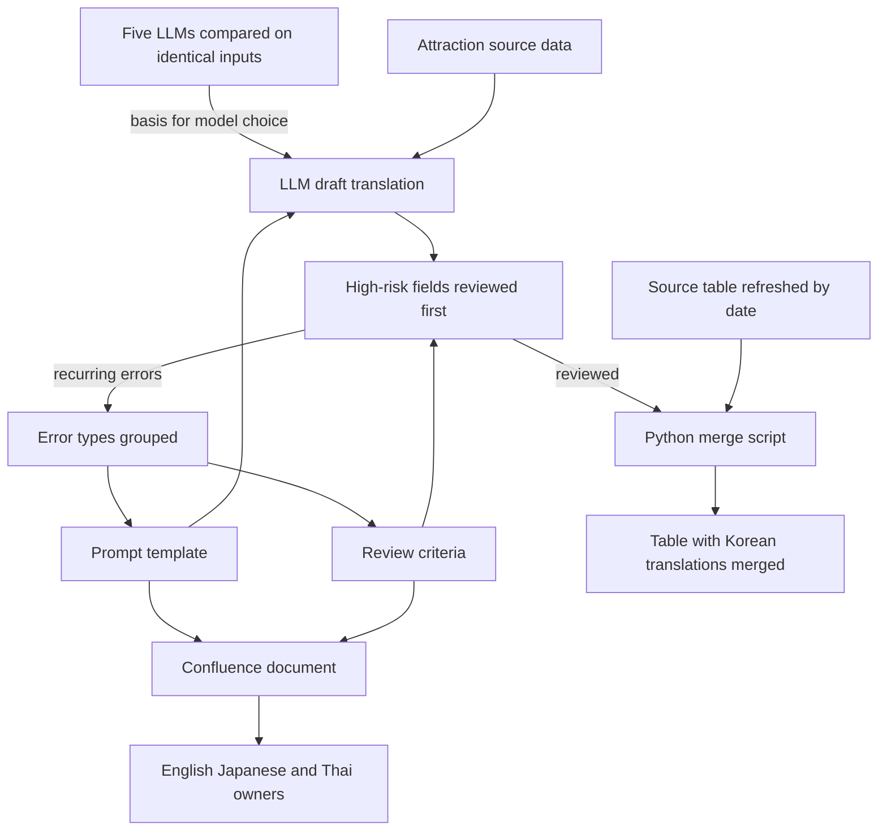

[한국어](./tripcom-llm-translation.md) | [English](./tripcom-llm-translation.en.md)

# Trip.com LLM Translation Pipeline — I was translating attraction data by hand, one entry at a time

> Trip.com Content Center | Intern, sole owner of Korean data | Nov 2024 to Feb 2025

I owned the Korean attraction (POI) data, and I was translating it myself, one entry at a time.

Looking at the task I had been given, I judged that an LLM would get it done far faster and more efficiently. So I proposed building an LLM translation pipeline in an internal document, and it went on to be applied in practice.

Korean coverage of the 9,755 attractions rated 4.0 or higher went from 72.3% to 100%.

---

## What I Did

### 1. Proposal — Translating one entry at a time left coverage at 72.3%

**Problem**: With translation done one entry at a time, Korean coverage of attractions rated 4.0 or higher stood at 72.3%. Looking at the task, it was work an LLM could finish far faster and more efficiently.

**Solution**: Proposed building an LLM translation pipeline in a written internal plan. Backed it with coverage by rating band, error examples from the existing translations, and translation comparisons with and without a prompt and across several LLMs. Included a fallback that could run even if API access was not approved.

**Result**: Applied to the Korean work.

### 2. Model comparison — I had to be able to say which model and why

**Problem**: Models differed in omissions, hallucinations, format compliance and tone. Customers would read these sentences, so reputation was no basis for choosing.

**Solution**: Gave the same attraction data to ChatGPT, Claude, Perplexity, DeepSeek and Kimi and compared them on four criteria: accuracy, fluency, proper-noun handling and format compliance. Ran the comparison by hand in each service's web interface.

**Result**: Used the errors on identical inputs as the basis for the model choice. In the comparison recorded in the plan, Kimi and Perplexity made more translation errors than ChatGPT.

### 3. Review order — Thousands of entries could not all be reviewed

**Problem**: The LLM drafts ran to thousands of entries, too many for a person to review one by one. The review needed an order.

**Solution**: Set the rule of reviewing high-risk fields first. Checked opening hours, addresses, place names and facility names first.

**Result**: Applied to the Korean work as a review that checks high-risk fields first. Reviewed new attractions against the same criteria.

### 4. Prompt template — The same errors kept recurring in LLM drafts

**Problem**: Mistranslations, omissions and wrong renderings of proper nouns kept recurring in the LLM drafts.

**Solution**: Designed a prompt template in four parts: source context, term mapping, output format and prohibited patterns. Set rules for writing proper nouns in Korean. Grouped the errors that came up often in review by type and fed them into the prohibited patterns and the review checklist.

**Result**: Built a loop in which errors found in review keep revising the template.

### 5. Merge script and documentation — This was not a one-off job

**Problem**: The source table was refreshed by date, so merging the translations into it was a recurring job. And if the LLM adoption stayed one person's work, every language would need a method of its own.

**Solution**: Wrote a Python script for the merge and processing step and ran it each time. Standardized the prompt template and review criteria validated on Korean as a Confluence document.

**Result**: Shared the document with the English, Japanese and Thai owners. Worked with each owner to apply it to their language.

---

## Results

| Item | Result | Conditions |
| --- | --- | --- |
| Korean coverage | 72.3% to 100% | 9,755 attractions in China rated 4.0 or higher; Nov 2024 vs. Feb 2025 |
| LLM comparison | Kimi and Perplexity made more errors than ChatGPT | Comparison recorded in the plan; same inputs; services as of the internship |
| Multilingual rollout | Prompt template and review criteria shared with three language owners and applied together | Shared after validation on the Korean work |

---

## More

<b>My scope and the team's</b>

- Me: proposing the plan, comparing five LLMs, designing the prompt template and review criteria, reviewing and correcting the Korean translations, the merge script, the Confluence documentation
- Other language owners: translation and review for English, Japanese and Thai. The translation results in those languages are theirs
- Together: applying the shared template and criteria to each language, and sharing how we used LLMs, the prompts, and the issues that came up
- Role: Technical Product Assistant. Location: Shanghai, China. Working language: Chinese

<b>Limitations</b>

- Coverage is the only result figure. There is no direct quality figure such as translation accuracy or a review pass rate
- Review was prioritized, high-risk fields first. Not every entry was reviewed
- The LLM comparison was done in web interfaces during the internship. No record puts all five side by side
- About three months of intern work. What happened after the internship is out of scope

<b>What you can check</b>

- The merge script, the actual prompts, the attraction source data, the internal plan and the Confluence document are company material and not public
- This page gives only the structure, the decisions and the figures. The diagram is my own redrawing of the flow I designed

---
