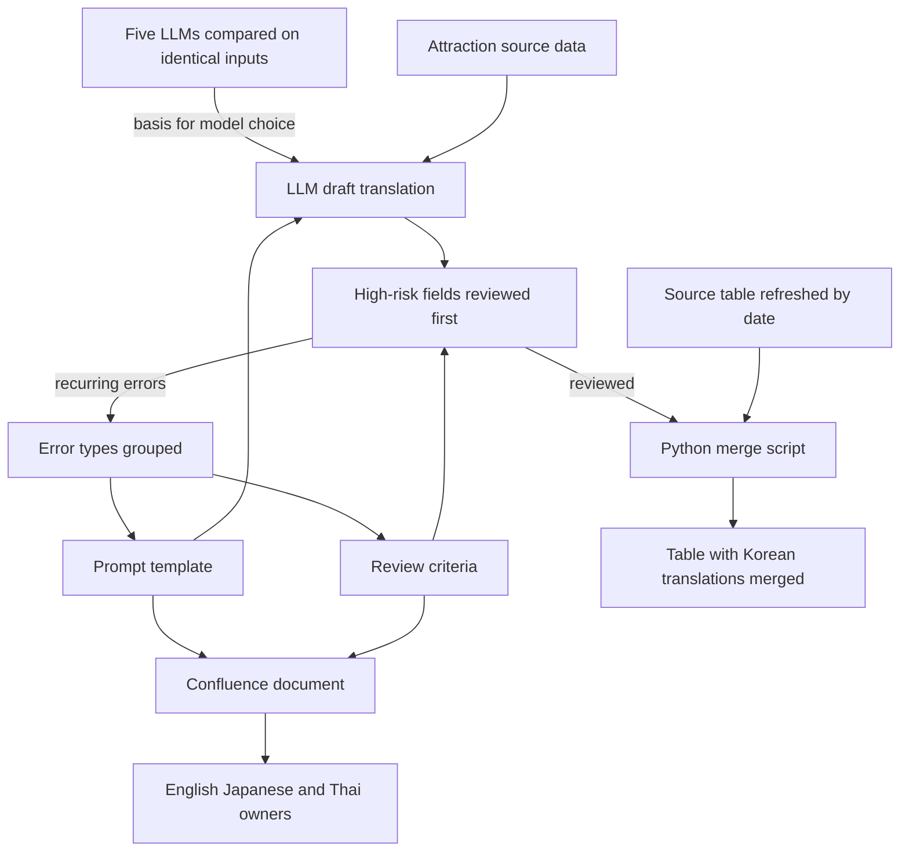

[한국어](./tripcom-llm-translation.md) | [English](./tripcom-llm-translation.en.md)

# Replaced manual attraction translation with an LLM translation and review pipeline, raising Korean coverage of 9,755 attractions from 72.3% to 100%

> As the Content Center intern who owned Korean attraction (POI) data at Trip.com, I proposed in an internal document that manual translation be replaced with LLM translation, and while applying it to the Korean work I set the review rule: check first the fields where an error harms a traveler.

## Overview

| Item | Details |
| --- | --- |
| Period | Nov 12, 2024 to Feb 18, 2025 (about three months) |
| Type | Internship, registered as my university's graduation internship. Trip.com Content Center, Shanghai, China. Role: Technical Product Assistant (Intern). Working language: Chinese |
| Team and my role | Sole owner of Korean attraction (POI) data; 100% of the Korean work. English, Japanese and Thai each had their own owner, and I worked with them by sharing the method and helping them apply it |
| Tech | LLMs (ChatGPT, Claude, Perplexity, DeepSeek, Kimi), prompt engineering, Python, Confluence |
| Headline result | Korean coverage of 9,755 attractions rated 4.0 or higher went from 72.3% to 100% (Nov 2024 vs. Feb 2025) |

## Problem

When I started, 72.3% of the attractions in China rated 4.0 or higher had Korean information. Translation was done by hand, one entry at a time, and I judged that this would never close the gap.

Filling the gaps was not enough on its own. Travelers act on attraction data exactly as written. Even where Korean text exists, a wrong place name, address or opening time means a wasted trip. Reviewing thousands of entries by hand was not possible either. Two things had to be settled first: which model to use and why, and what to review first.

## What I did and why

The diagram is my own redrawing of the translation and review flow I designed. An LLM drafts the translation, a person reviews the high-risk fields first, and errors that recur in review feed back into the prompt template and the review criteria.

### 1. Nobody asked for this, so I started with a written proposal backed by the current numbers and a comparison

Nobody had asked for AI here. So I gathered the evidence first and wrote the proposal for adopting LLM translation myself. It laid out coverage by rating band, examples of errors in the existing translations split into mistranslations and unnatural phrasing, and translation comparisons with and without a prompt and across several LLMs. It also set out a fallback that could run even if API access was not approved.

### 2. I compared models by the errors they made on identical inputs

To automate with an LLM, I thought I first had to be able to say which model and why. Models differed in omissions, hallucinations, format compliance and tone. Because customers would read these sentences, I judged the models by their errors on the same input rather than by reputation. I gave the same attraction data to five LLM services (ChatGPT, Claude, Perplexity, DeepSeek and Kimi) and compared them on four criteria: accuracy, fluency, proper-noun handling and format compliance. That comparison was the basis for the model choice. I ran it by hand in each service's web interface.

What I kept in writing is in the proposal: a comparison of translation outputs and the error examples. In that comparison, Kimi and Perplexity made more translation errors than ChatGPT. This reflects the services as they were during the internship (Nov 2024 to Feb 2025).

### 3. I gave up reviewing everything and checked first the fields where an error harms a traveler

I judged that having a person review every entry does not fit bulk processing. So while applying the method to the Korean work, I decided what to look at first.

| Fields reviewed first | What happens to the traveler if it is wrong |
| --- | --- |
| Opening hours | They arrive to find the place closed |
| Addresses, and proper nouns such as place and facility names | They end up in the wrong place |

Instead of going through all of the thousands of entries, I checked these high-risk fields first. New attractions were reviewed against the same criteria.

### 4. I grouped the mistranslations, omissions and proper-noun errors that recurred in LLM drafts by type and turned them into the prompt's prohibited patterns and review checklist items

Errors in the LLM drafts recurred in three forms: mistranslations, omissions, and wrong Korean renderings of proper nouns such as place and facility names.

The prompt has four parts: source context, term mapping, output format and prohibited patterns. The aim was a template that could be reused. For proper nouns such as place and facility names, I set the rules for writing them in Korean.

I grouped the mistranslations, omissions and proper-noun errors that came up often in review by type. Each type went into the prompt's prohibited patterns and the review checklist, and I revised the template by repeating this loop.

### 5. To keep it from being a one-off, I scripted the merge and documented the method

The company refreshed the source table by date, so merging the translations into it was a recurring job. I wrote a Python script for this merge and processing step and ran it each time.

I also wrote the method down so that the LLM adoption would not end as one person's work. Instead of building a separate method for each language, I standardized the prompt template and review criteria validated on Korean as a Confluence document and shared it with the English, Japanese and Thai owners. Each owner applied it to their own language, and I helped them do so.

## Results and verification

| Item | Result | Conditions |
| --- | --- | --- |
| Korean coverage | 72.3% to 100% | 9,755 attractions in China rated 4.0 or higher. Share of attractions that have Korean information. Nov 2024 vs. Feb 2025 |
| LLM comparison | Kimi and Perplexity made more translation errors than ChatGPT | The comparison recorded in the proposal. Same attraction inputs. Services as they were during the internship (Nov 2024 to Feb 2025) |
| Multilingual rollout | Prompt template and review criteria standardized in Confluence and shared with the English, Japanese and Thai owners; support for applying them in each language | Shared after validation on the Korean work |

Coverage compares the value in November 2024, when the internship began, with the value in February 2025, when it ended. I reviewed the translations myself, in the order described in section 3.

## My scope and the team's scope

I did the Korean work alone. English, Japanese and Thai each had their own owner, and the translation results in those languages are theirs.

| Who | Scope |
| --- | --- |
| Me | Writing and proposing the LLM translation plan, comparing five LLMs, designing the prompt template and review criteria, reviewing and correcting the Korean translations, writing the Python merge script, documenting the method in Confluence |
| Other language owners | Translation and review for English, Japanese and Thai. Applying the shared prompt template and review criteria to their own language |
| Together | Sharing how we used LLMs, the prompts, and the issues that came up |

## Limitations

- The only result figure is coverage. There is no figure that measures translation quality directly, such as accuracy or a review pass rate.
- Review was prioritized: opening hours, addresses, place names and facility names came first. There was no exhaustive review of every entry.
- The five-LLM comparison was done by hand in each service's web interface. What remains in writing is the comparison in the proposal, and there is no record that puts all five side by side.
- The LLM comparison reflects the services as they were during the internship. It cannot be assumed to hold for today's models.
- This was about three months of intern work. How the process ran after the internship is outside the scope of this document.

## What you can check

- [Translation and review flow diagram](#what-i-did-and-why): my redrawing of the flow I designed.
- [Review order table](#3-i-gave-up-reviewing-everything-and-checked-first-the-fields-where-an-error-harms-a-traveler): the fields reviewed first, and why.
- The merge script, the actual prompts, the attraction source data, the internal proposal and the Confluence document are company work material and are not public. This document gives only the structure, the decisions and the figures.
