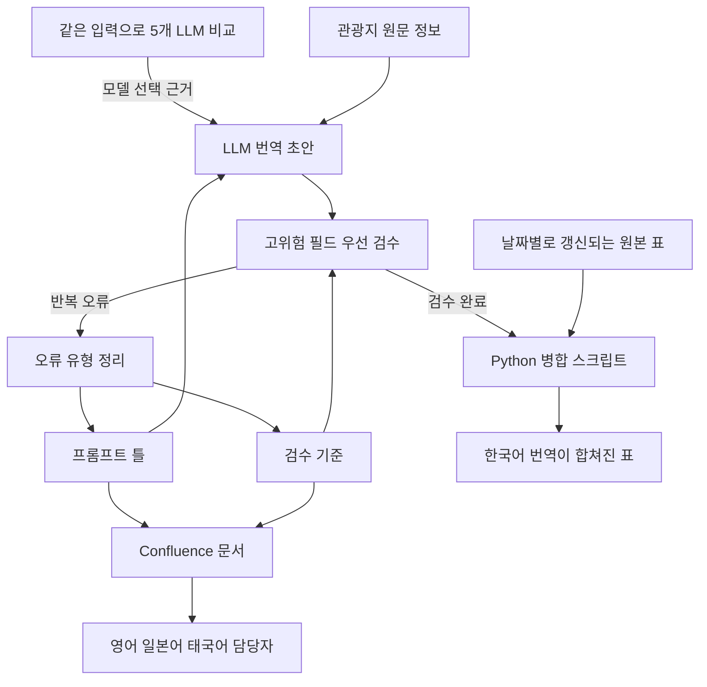

[한국어](./tripcom-llm-translation.md) | [English](./tripcom-llm-translation.en.md)

# 수작업 관광지 번역을 LLM 번역과 검수 파이프라인으로 바꿔 9,755곳의 한국어 커버리지를 72.3%에서 100%로 높였습니다

> Trip.com Content Center 인턴으로 관광지(POI) 한국어 데이터를 전담하며 수작업 번역을 LLM 번역으로 바꾸는 계획을 사내 문서로 제안했고, 한국어 업무에 적용하면서 틀리면 여행자가 피해를 보는 필드부터 검수하는 기준을 세웠습니다.

## 개요

| 항목 | 내용 |
| --- | --- |
| 기간 | 2024.11.12 ~ 2025.02.18 (약 3개월) |
| 형태 | 인턴(학교 졸업실습 과정). Trip.com Content Center, 중국 상하이. 직무 Technical Product Assistant, 중국어로 업무 |
| 팀과 내 역할 | 관광지(POI) 한국어 데이터 전담, 한국어 작업 기여도 100%. 영어, 일본어, 태국어는 각 언어 담당자가 맡았고 방법 공유와 적용 지원으로 협업 |
| 기술 | LLM(ChatGPT, Claude, Perplexity, DeepSeek, Kimi), Prompt Engineering, Python, Confluence |
| 대표 결과 | 평점 4.0 이상 관광지 9,755곳의 한국어 커버리지 72.3%에서 100% (2024.11과 2025.02 비교) |

## 문제

인턴을 시작했을 때 평점 4.0 이상 중국 관광지 가운데 한국어 정보가 있는 곳은 72.3%였습니다. 번역은 사람이 한 건씩 하고 있었고, 이 방식으로는 공백을 메울 수 없다고 봤습니다.

빈 곳을 채우는 것만으로는 충분하지 않았습니다. 관광지 정보는 여행자가 그대로 따라 움직이는 정보입니다. 한국어 정보가 있어도 지명, 주소, 운영시간이 틀리면 여행자는 헛걸음을 합니다. 그렇다고 수천 건을 사람이 모두 검수할 수도 없었습니다. 어떤 모델을 왜 쓰는지, 무엇부터 검수하는지를 먼저 정해야 했습니다.

## 내가 한 일과 판단

제가 설계한 번역과 검수 흐름을 이 문서에서 다시 그렸습니다. LLM이 번역 초안을 만들고, 사람이 고위험 필드부터 검수하고, 검수에서 되풀이된 오류가 프롬프트 틀과 검수 기준으로 되돌아가는 구조입니다.

### 1. 지시 없이 시작한 일이라, 현황과 비교 결과를 담은 계획서로 먼저 제안했습니다

AI 도입을 요구한 사람은 없었습니다. 그래서 근거부터 모아 LLM 번역 도입 계획서를 직접 썼습니다. 계획서에는 평점 구간별 커버리지 현황, 기존 번역의 오류를 오역과 부자연스러운 번역으로 나눈 사례, 프롬프트 유무와 여러 LLM의 번역 비교 결과를 담았습니다. API 승인이 나지 않아도 실행할 수 있는 대안도 함께 적었습니다.

### 2. 모델은 같은 입력에서 나온 오류로 비교했습니다

LLM으로 자동화하려면 어떤 모델을 왜 쓰는지부터 답할 수 있어야 한다고 봤습니다. 모델마다 누락, 환각, 형식 준수, 문체가 달랐습니다. 고객이 읽을 문장이라 이름값 대신 같은 입력의 오류로 따졌습니다. ChatGPT, Claude, Perplexity, DeepSeek, Kimi 다섯 LLM 서비스에 같은 관광지 정보를 넣고 정확도, 자연스러움, 고유명사 표기, 형식 준수 네 가지 기준으로 비교해 모델 선택의 근거로 삼았습니다. 비교는 각 서비스의 웹 화면에서 직접 했습니다.

문서로는 계획서에 번역 결과 비교와 오류 사례를 남겼습니다. 그 비교에서는 Kimi와 Perplexity가 ChatGPT보다 번역 오류가 많았습니다. 인턴 기간(2024.11 ~ 2025.02) 당시의 결과입니다.

### 3. 전수 검수를 포기하고, 틀리면 여행자가 피해를 보는 필드부터 확인했습니다

사람이 전부 검수하는 방식은 대량 처리에 맞지 않다고 판단했습니다. 그래서 한국어 업무에 적용하면서 무엇부터 볼지를 정했습니다.

| 먼저 검수한 필드 | 틀리면 여행자에게 생기는 일 |
| --- | --- |
| 운영시간 | 닫힌 문 앞에 서게 됨 |
| 주소, 지명과 시설명 같은 고유명사 | 엉뚱한 곳에 가게 됨 |

수천 건을 모두 보는 대신 이 고위험 필드를 먼저 확인했습니다. 신규 관광지도 같은 기준으로 검수했습니다.

### 4. LLM 초안에서 되풀이된 오역, 누락, 고유명사 오류를 유형으로 묶어 프롬프트의 금지 규칙과 검수 항목으로 옮겼습니다

LLM 초안의 오류는 세 가지로 되풀이됐습니다. 오역, 누락, 지명과 시설명 같은 고유명사의 표기 오류입니다.

프롬프트는 원문 맥락, 용어 매핑, 출력 형식, 금지 규칙으로 나눴습니다. 반복해서 쓸 수 있는 틀로 만들기 위해서였습니다. 지명과 시설명 같은 고유명사는 한국어 표기 기준을 세웠습니다.

검수에서 자주 나온 오역, 누락, 고유명사 오류는 유형별로 묶었습니다. 묶은 유형은 프롬프트의 금지 규칙과 검수 항목에 반영했고, 이 과정을 되풀이하며 틀을 고쳤습니다.

### 5. 한 번으로 끝나지 않도록 병합은 스크립트로, 방법은 문서로 남겼습니다

회사가 날짜별로 갱신하는 원본 표에 번역본을 합치는 일이 되풀이됐습니다. 이 병합과 가공을 Python 스크립트로 만들어 반복 운영했습니다.

LLM 도입이 한 사람의 작업으로 끝나지 않게 하려고 방법도 문서로 남겼습니다. 언어마다 방법을 새로 만드는 대신, 한국어에서 검증한 프롬프트 틀과 검수 기준을 Confluence 문서로 표준화했습니다. 이 문서를 영어, 일본어, 태국어 담당자와 공유했습니다. 각 언어에 적용하는 일은 그 언어 담당자가 했고, 저는 적용을 도왔습니다.

## 결과와 검증

| 항목 | 결과 | 조건 |
| --- | --- | --- |
| 한국어 커버리지 | 72.3%에서 100% | 평점 4.0 이상 중국 관광지 9,755곳 대상. 한국어 정보가 있는 관광지의 비율. 2024.11과 2025.02 비교 |
| LLM 비교 | Kimi와 Perplexity가 ChatGPT보다 번역 오류가 많음 | 계획서에 남긴 비교. 같은 관광지 입력. 인턴 기간(2024.11 ~ 2025.02) 당시의 결과 |
| 다국어 적용 | 프롬프트 틀과 검수 기준을 Confluence 문서로 표준화해 영어, 일본어, 태국어 담당자와 공유, 각 언어 적용 지원 | 한국어 업무에서 검증한 뒤 공유 |

커버리지는 인턴을 시작한 2024년 11월과 마친 2025년 2월의 값을 비교했습니다. 번역 내용은 위 3번의 순서대로 제가 검수했습니다.

## 내 범위와 팀 범위

한국어 작업은 혼자 했습니다. 영어, 일본어, 태국어는 각 언어 담당자가 맡았고, 그 언어의 번역 결과는 담당자의 결과입니다.

| 구분 | 범위 |
| --- | --- |
| 내가 한 일 | LLM 번역 도입 계획서 작성과 제안, 5개 LLM 비교, 프롬프트 틀과 검수 기준 설계, 한국어 번역 검수와 수정, 병합 Python 스크립트 작성, Confluence 문서화 |
| 다른 언어 담당자가 한 일 | 영어, 일본어, 태국어의 번역과 검수. 공유한 프롬프트 틀과 검수 기준을 각 언어에 적용 |
| 함께 한 일 | LLM 활용 방식, 프롬프트, 발생한 이슈의 공유 |

## 한계

- 결과 수치는 커버리지 하나입니다. 번역 정확도나 검수 통과율처럼 품질을 직접 잰 수치는 없습니다.
- 검수는 운영시간, 주소, 지명, 시설명을 먼저 보는 우선순위 방식이었습니다. 전수 검수는 하지 않았습니다.
- 다섯 LLM 비교는 각 서비스의 웹 화면에서 직접 한 것입니다. 문서로 남긴 것은 계획서의 비교이고, 다섯을 모두 한자리에 놓은 기록은 없습니다.
- LLM 비교 결과는 인턴 기간 당시의 서비스에서 나온 것입니다. 지금의 모델에도 같다고 볼 수 없습니다.
- 약 3개월의 인턴 기간에 한 일입니다. 인턴이 끝난 뒤의 운영은 이 문서의 범위 밖입니다.

## 확인할 자료

- [번역과 검수 흐름도](#내가-한-일과-판단): 제가 설계한 흐름을 다시 그린 그림입니다.
- [검수 순서 표](#3-전수-검수를-포기하고-틀리면-여행자가-피해를-보는-필드부터-확인했습니다): 먼저 검수한 필드와 그 이유입니다.
- 병합 스크립트, 프롬프트 원문, 관광지 원자료, 사내 계획서와 Confluence 문서: 회사 업무 자료여서 공개하지 않습니다. 이 문서에는 구조와 판단, 수치만 적었습니다.
