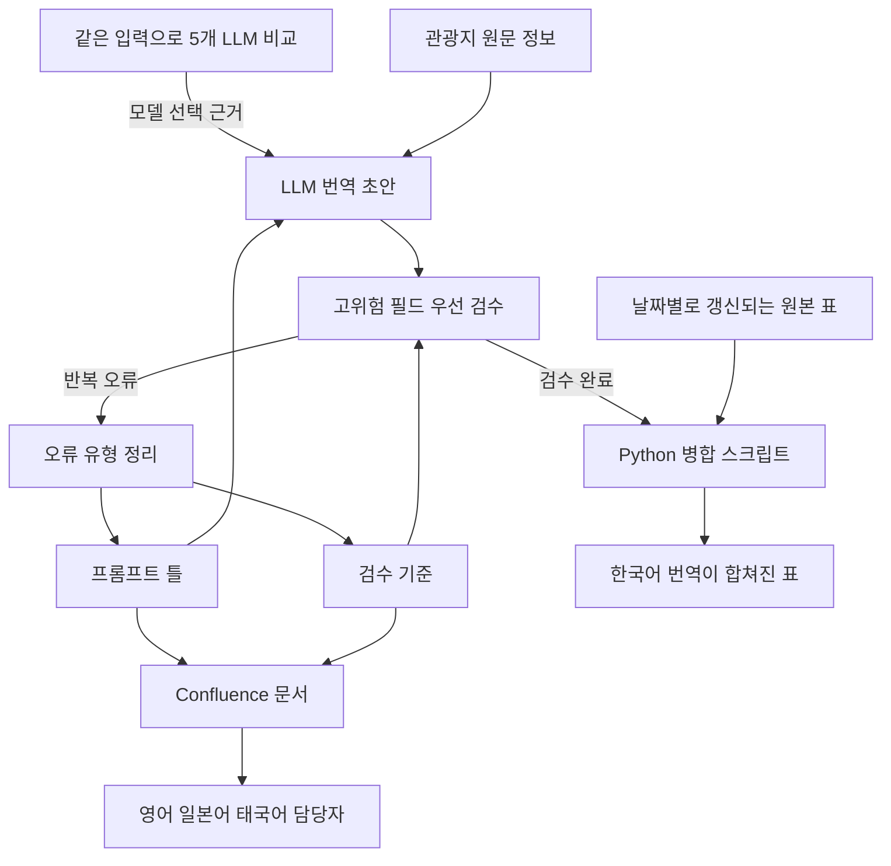

[한국어](./tripcom-llm-translation.md) | [English](./tripcom-llm-translation.en.md)

# Trip.com LLM 번역 파이프라인 — 관광지 번역을 한 건씩 수작업으로 하고 있었다

> Trip.com Content Center | 인턴, 한국어 데이터 전담 | 2024.11 ~ 2025.02

관광지(POI) 한국어 데이터를 전담했고, 번역은 제가 한 건씩 하고 있었습니다.

AI 도입을 요구한 사람은 없었지만, 맡은 임무를 보니 LLM을 활용하면 훨씬 효율적으로 빨리 끝낼 수 있는 일이라고 판단했습니다. 그래서 LLM 번역 파이프라인 제작을 사내 문서로 제안했고, 실제 적용까지 이어졌습니다.

평점 4.0 이상 관광지 9,755곳의 한국어 커버리지가 72.3%에서 100%가 됐습니다.

---

## 한 일

### 1. 제안 — AI 도입을 요구한 사람은 없었다

**문제**: AI 도입을 요구한 사람은 없었다. 맡은 임무는 LLM을 활용하면 훨씬 효율적으로 빨리 끝낼 수 있는 일이었다.

**해결**: LLM 번역 파이프라인 제작을 사내 계획서로 제안. 평점 구간별 커버리지 현황, 기존 번역의 오류 사례, 프롬프트 유무와 여러 LLM의 번역 비교를 근거로 정리. API 승인이 나지 않아도 실행할 수 있는 대안 포함.

**결과**: 한국어 업무에 실제 적용.

### 2. 모델 비교 — 어떤 모델을 왜 쓰는지 답할 수 있어야 했다

**문제**: 모델마다 누락, 환각, 형식 준수, 문체가 달랐다. 고객이 읽을 문장이라 이름값으로 고를 수 없었다.

**해결**: ChatGPT, Claude, Perplexity, DeepSeek, Kimi에 같은 관광지 정보를 넣고 정확도, 자연스러움, 고유명사 표기, 형식 준수 네 기준으로 비교. 각 서비스의 웹 화면에서 직접 수행.

**결과**: 같은 입력에서 나온 오류를 모델 선택의 근거로 사용. 계획서에 남긴 비교에서는 Kimi와 Perplexity가 ChatGPT보다 번역 오류가 많음.

### 3. 검수 순서 — 수천 건을 모두 검수할 수는 없었다

**문제**: 관광지 정보는 여행자가 그대로 따라 움직이는 정보다. 지명, 주소, 운영시간이 틀리면 헛걸음을 하는데, 수천 건을 사람이 모두 검수할 수는 없었다.

**해결**: 틀리면 여행자가 피해를 보는 필드부터 검수하는 기준 수립. 닫힌 문 앞에 서게 되는 운영시간, 엉뚱한 곳에 가게 되는 주소와 지명, 시설명을 먼저 확인.

**결과**: 고위험 필드를 먼저 확인하는 방식으로 한국어 업무에 적용. 신규 관광지도 같은 기준으로 검수.

### 4. 프롬프트 틀 — LLM 초안에서 같은 오류가 되풀이됐다

**문제**: LLM 초안에서 오역, 누락, 고유명사 표기 오류가 되풀이됐다.

**해결**: 프롬프트를 원문 맥락, 용어 매핑, 출력 형식, 금지 규칙으로 나눈 틀 설계. 고유명사의 한국어 표기 기준 수립. 검수에서 자주 나온 오류를 유형별로 묶어 금지 규칙과 검수 항목에 반영.

**결과**: 검수에서 나온 오류로 틀을 되풀이해 고치는 구조.

### 5. 병합과 문서화 — 한 번 하고 끝나는 일이 아니었다

**문제**: 날짜별로 갱신되는 원본 표에 번역본을 합치는 일이 되풀이됐다. LLM 도입이 한 사람의 작업으로 끝나면 언어마다 방법을 새로 만들어야 했다.

**해결**: 병합과 가공을 Python 스크립트로 만들어 반복 운영. 한국어에서 검증한 프롬프트 틀과 검수 기준을 Confluence 문서로 표준화.

**결과**: 문서를 영어, 일본어, 태국어 담당자와 공유. 각 언어 적용은 그 언어 담당자와 같이 작업.

---

## 결과

| 항목 | 결과 | 조건 |
| --- | --- | --- |
| 한국어 커버리지 | 72.3%에서 100% | 평점 4.0 이상 중국 관광지 9,755곳, 2024.11과 2025.02 비교 |
| LLM 비교 | Kimi와 Perplexity가 ChatGPT보다 오류 많음 | 계획서에 남긴 비교, 같은 입력, 인턴 기간 당시 |
| 다국어 적용 | 프롬프트 틀과 검수 기준을 3개 언어 담당자와 공유, 같이 적용 | 한국어 업무에서 검증한 뒤 공유 |

---

## 더 보기

<b>내 범위와 팀 범위</b>

- 내가 한 일: 계획서 제안, 5개 LLM 비교, 프롬프트 틀과 검수 기준 설계, 한국어 번역 검수와 수정, 병합 스크립트, Confluence 문서화
- 다른 언어 담당자가 한 일: 영어, 일본어, 태국어의 번역과 검수. 그 언어의 번역 결과는 담당자의 결과
- 함께 한 일: 공유한 틀과 기준의 각 언어 적용, LLM 활용 방식과 프롬프트와 발생한 이슈의 공유
- 직무는 Technical Product Assistant, 근무지는 중국 상하이, 업무 언어는 중국어

<b>한계</b>

- 결과 수치는 커버리지 하나. 번역 정확도나 검수 통과율 같은 품질 수치는 없음
- 검수는 고위험 필드를 먼저 보는 우선순위 방식. 전수 검수는 하지 않음
- LLM 비교는 인턴 기간 당시 웹 화면에서 한 것. 다섯을 한자리에 놓은 기록은 없음
- 약 3개월 인턴 기간의 일. 인턴이 끝난 뒤의 운영은 범위 밖

<b>확인할 자료</b>

- 병합 스크립트, 프롬프트 원문, 관광지 원자료, 사내 계획서와 Confluence 문서는 회사 자료라 비공개
- 이 문서에는 구조와 판단, 수치만 기재. 흐름도는 직접 설계한 흐름을 다시 그린 것

---
