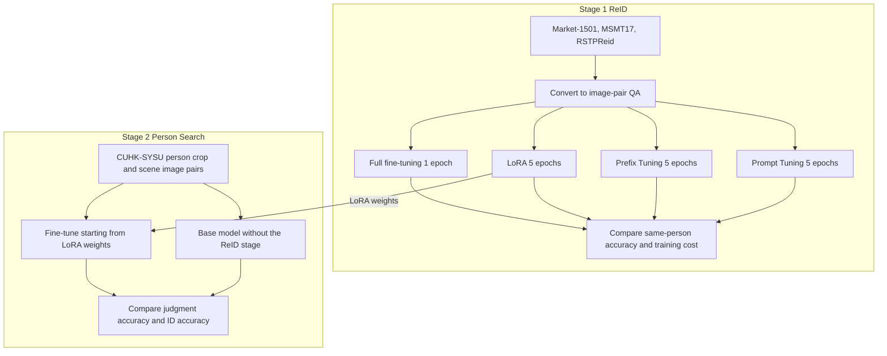

[한국어](./vlm-person-reid-thesis.md) | [English](./vlm-person-reid-thesis.en.md)

# Fine-tuned a 7B vision-language model to 97.05% same-person accuracy on Market-1501, and raised Person Search ID accuracy from 71.76% to 78.57% with a two-stage transfer

> Individual research: I fine-tuned LLaVA-Interleave-Qwen-7B to answer whether two images show the same person and what the person IDs are, compared full fine-tuning with three PEFT methods under matched total training time on limited GPUs, and reused the ReID-stage LoRA weights as the starting point for Person Search training.

## Overview

| Item | Details |
| --- | --- |
| Period | Mar 2025 to May 2025 |
| Type | Individual research. Undergraduate graduation thesis at Fudan University, "Research on Pedestrian Recognition Based on Multimodal Large Models" |
| Team and my role | Solo research, 100% contribution. First author of the two conference papers written from the same research |
| Tech | LLaVA-Interleave-Qwen-7B, PyTorch, Hugging Face Transformers, PEFT (LoRA, Prefix Tuning, Prompt Tuning), DeepSpeed, Alibaba Cloud GPU. Training scripts run from a fork of the open-source lmms-finetune framework |
| Headline result | 97.05% same-person accuracy (Market-1501, full fine-tuning). Two-stage transfer raised Person Search judgment accuracy from 87.47% to 92.86% and ID accuracy from 71.76% to 78.57% (CUHK-SYSU, against the base model). Two first-author conference papers (both accepted for publication) |

## Problem

Person re-identification (ReID) finds the same person across different cameras, times and places, and is used in intelligent video surveillance. Existing methods that compare image features alone are weak against changes in lighting, pose, viewpoint and occlusion. Whether a vision-language model (VLM) could do this task had to be settled by experiment.

The problem was training cost. On the limited GPUs I had, training all of a 7B model took 2 to 3 hours per epoch, and full fine-tuning also risks forgetting what the model learned in pretraining. So I set two questions: can a VLM do person re-identification, and which fine-tuning method should you choose when compute is limited?

## What I did and why



### 1. I recast re-identification as question answering over image pairs, so the model itself answers whether it is the same person and gives the IDs

LLaVA-Interleave-Qwen-7B accepts several images interleaved in one input, but during pretraining it had never seen a task that compares the people in two images. So I converted Market-1501, MSMT17, RSTPReid and CUHK-SYSU into question-answer data that asks whether the people in two images are the same and what their IDs are. For the ReID datasets, positive pairs come from images with the same ID, and an equal number of negative pairs come from randomly chosen images with different IDs. RSTPReid was split into two conditions, with and without the text descriptions of each person.

A converted MSMT17 sample from late April 2025, as it remains in the public fork:

```text
Q: <image> Are these two people the same?<image> Also, guess the person-ID of each image.
A: no, id1: 178, id2: 864
```

This makes evaluation harder, because a generative model may not give a same-or-different answer at all. The metrics include a response rate, and same-person accuracy is counted two ways: over all evaluation pairs, and over answered pairs only. I also measured precision, recall and F1. ID accuracy was measured in Person Search.

### 2. I set full fine-tuning as the upper-bound baseline and compared three PEFT methods under matched total training time

Rather than chase the single highest accuracy, I designed the comparison to find the balance between performance and cost. Full fine-tuning was the baseline, compared against LoRA (rank 8), Prefix Tuning (prefix lengths 32 and 96) and Prompt Tuning. LoRA was applied to both the language model and the image encoder.

In preliminary runs, full fine-tuning took about five times as long to train as PEFT. So I matched total training time instead of epoch count: 1 epoch for full fine-tuning, 5 epochs for each PEFT method. The scheduler (cosine), warmup ratio (0.03) and mixed-precision setting were the same for all four methods, and the learning rate was set per method. The cost of this choice is that full fine-tuning saw the training data only once.

### 3. Three training errors surfaced together; I split them into the smallest reproducible units and fixed them one by one

While training a 7B model on limited GPUs, I hit a multi-GPU configuration error, an image-token count mismatch and a conflict with DeepSpeed's sparse attention at the same time, and could not tell which one was the cause. I gave up trying to fix everything at once, read the logs from the top and separated the errors one at a time. For each error I built the smallest run that reproduced it, confirmed the cause there and fixed it. Only after resolving the three in turn did training run to the end.

The public fork still has commits from this period that changed image-token handling. In the LLaVA-Interleave loader and collator, they set the processor's patch_size (14) and vision_feature_select_strategy explicitly, and comment out the collator code that expanded image tokens by hand.

### 4. I designed a two-stage transfer that reuses the ReID-stage LoRA weights as the starting point for Person Search training

Person Search takes a cropped image of a person and a full scene image, and asks whether that person is in the scene and what their ID is. I built these pairs from CUHK-SYSU and initialized stage 2 with the weights of LoRA, which had the highest accuracy among the PEFT methods on Market-1501 and MSMT17 in stage 1.

Full fine-tuning had the highest accuracy in stage 1. But the research assumed limited compute, so stage 2 used LoRA, which trains under 0.1% of the parameters. I checked the effect of the transfer by comparing, under the same conditions, against a base model that had not gone through the ReID stage.

## Results and verification

Table 1. Stage 1 ReID: same-person accuracy and training cost. Accuracy is computed over all evaluation image pairs; pairs for which the model gave no judgment stay in the denominator.

| Method | Trainable parameters (share of total) | Training time per epoch | Market-1501 | MSMT17 | RSTPReid (no text descriptions) |
| --- | --- | --- | --- | --- | --- |
| Full fine-tuning, 1 epoch | about 7 billion (100%) | 2 to 3 hours | 97.05% | 96.15% | 91.75% |
| LoRA rank 8, 5 epochs | about 4.7 million (under 0.1%) | 30 to 40 minutes | 82.45% | 83.76% | 42.17% |

- Full fine-tuning was the highest of the four methods on Market-1501 and MSMT17, which showed that a VLM can do person re-identification.
- On Market-1501 and MSMT17, LoRA was the best of the PEFT methods. Training under 0.1% of the parameters, it reached about 87% of full fine-tuning's accuracy on MSMT17 (83.76% / 96.15%), and time per epoch fell from 2 to 3 hours to 30 to 40 minutes.
- Prefix Tuning (lengths 32 and 96) and Prompt Tuning had lower same-person accuracy than LoRA on both datasets, and Prefix Tuning swung widely with the number of tokens.

Table 2. Stage 2 Person Search (CUHK-SYSU), against the base model.

| Metric | Base model | Starting from ReID LoRA weights | Difference |
| --- | --- | --- | --- |
| Judgment accuracy: is the person in the scene (over all evaluation pairs) | 87.47% | 92.86% | +5.39 pp |
| ID accuracy | 71.76% | 78.57% | +6.81 pp |

The figures in both tables are the values in Tables 3.1, 3.3 and 3.4 of the final thesis. The stage 1 figures for Market-1501 and MSMT17 also appear in the ITAM paper, and the stage 2 figures in the ChineseCSCW paper.

## Papers

Both papers were written from this thesis research; both have been accepted for publication, and I am the first author of both.

1. **Kim, H. J.**, et al. (2025). "A Study of Person Re-identification Based on Vision-Language Multimodal Large Language Model." 31st International Conference on IT Applications and Management (ITAM-31), held Oct 26 to 30, 2025. Proceedings pp. 252-259, ISSN 2334-0114.
   Whether a VLM can be applied to ReID, and how performance and training cost differ by fine-tuning method.
2. **Kim, H. J.**, et al. (2025). "A Cost-Effective Training Method for Large Models in Pedestrian Search Task." 20th CCF Conference on Computer Supported Cooperative Work and Social Computing (ChineseCSCW 2025), held Nov 7 to 9, 2025.
   A staged training method that initializes Person Search with the ReID-stage LoRA weights.

## Limitations

- The reported figures are same-person judgment accuracy on image pairs. The thesis has no standard ReID retrieval metrics (mAP, Rank-1), which rank candidates across a whole gallery, so the figures cannot be compared directly with published results of existing ReID methods.
- On RSTPReid without text descriptions, LoRA reached only 42.17% same-person accuracy, and precision, recall and F1 for the "same person" class were all 0%. The thesis did not analyze the cause and only noted possible undertraining or imbalance. Figures for the with-descriptions condition are not included.
- Because the comparison matches total training time, the number of epochs (1 vs. 5), the learning rate and the weight decay differ by method.
- The work confirmed the limits of predicting an ID expressed only as a number: ID accuracy is still 78.57% after stage 2. The thesis proposes learnable identity tokens and attribute labels such as clothing color and carried items as directions for improvement.
- The script settings in the public fork (a 4-bit quantization option, the learning rate) and the notebook's pair-generation method date from late April 2025 and differ from the final settings written in the thesis. The evaluation code and checkpoints are not in the public repository.

## What you can check

- [khj1212k/lmms-finetune](https://github.com/khj1212k/lmms-finetune): my fork of the training scripts from the thesis period. The upstream repository is zjysteven/lmms-finetune, and my commits are the five from 2025-04-29 to 2025-05-08. The commit messages record only the uploads, so what changed can be checked in the diffs and the notes on the two commits below.
- [Loader commit](https://github.com/khj1212k/lmms-finetune/commit/a4e4dc676e7ace9de80096132c0d692d400c7964) and [collator commit](https://github.com/khj1212k/lmms-finetune/commit/5ba914e99cf8b015df32d76d67dc38e4f50ce3fe): changes to LLaVA-Interleave image-token handling (2025-04-29)
- [llava_msmt17.sh](https://github.com/khj1212k/lmms-finetune/blob/541c909e6c2a5c66872e64d9d0ae1d5aaa1191e2/llava_msmt17.sh): the MSMT17 training launch script. LoRA rank 8, 4-bit quantization option (Q_LORA), LoRA on the image encoder, DeepSpeed ZeRO-2, set for 2 GPUs (NUM_GPUS=2)
- [Data conversion commit](https://github.com/khj1212k/lmms-finetune/commit/997a7ab60165abc1ee4368e8324214aecd643f29): an early notebook that converts MSMT17 into image-pair QA (one negative pair per ID), and the converted file msmt17_train_full_55.jsonl (1,041 positive and 1,041 negative pairs). The files hold image paths and question-answer text only, no images.
- Person images from the datasets are not included because of the datasets' terms of use.
- The full text of the two papers and the thesis text (in Chinese) are not in this repository; the papers are given as bibliographic details only.
