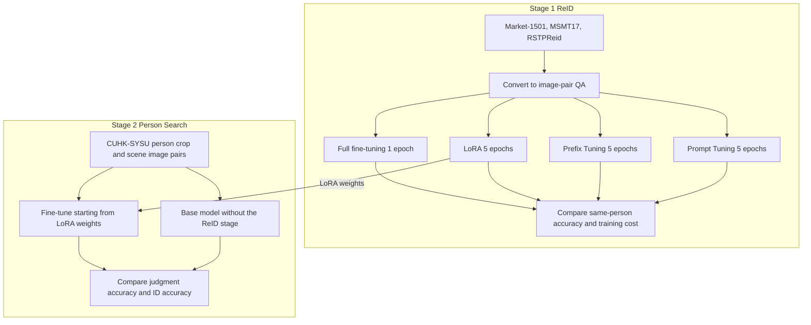

[한국어](./vlm-person-reid-thesis.md) | [English](./vlm-person-reid-thesis.en.md)

# Person Re-identification with a Vision-Language Model — Whether a VLM could do it had to be tested

> Fudan University graduation thesis | Individual research | Mar to May 2025

This is my undergraduate graduation thesis, "Research on Pedestrian Recognition Based on Multimodal Large Models", in which I fine-tuned LLaVA-Interleave-Qwen-7B to answer whether two images show the same person and what the person IDs are.

On limited GPUs I compared full fine-tuning with three PEFT methods under matched total training time, and reused the ReID-stage LoRA weights as the starting point for Person Search training.

The model reached 97.05% same-person accuracy on Market-1501, and the same research produced two first-author conference papers.

---

## What I Did

Training ran on Alibaba Cloud GPUs with PyTorch, Hugging Face Transformers, PEFT and DeepSpeed, from a fork of the open-source lmms-finetune framework.

### 1. Recasting the task — The model had never compared the people in two images

**Problem**: LLaVA-Interleave-Qwen-7B accepts several images in one input, but its pretraining never included a task that compares the people in two images.

**Solution**: Converted Market-1501, MSMT17, RSTPReid and CUHK-SYSU into question-answering data that asks whether two people are the same and what their IDs are. Built positive pairs from images with the same ID and an equal number of negative pairs from images drawn at random from different IDs.

**Result**: Added response rate as a metric, because a generative model may not answer at all. Reported judgment accuracy separately over all evaluation pairs and over answered pairs.

### 2. Comparison design — Full fine-tuning took about five times as long as PEFT

**Problem**: The GPU budget was limited: training all of a 7B model took two to three hours per epoch. In a preliminary run, full fine-tuning took about five times as long as PEFT.

**Solution**: Set full fine-tuning as the upper-bound baseline and compared LoRA at rank 8, Prefix Tuning at lengths 32 and 96, and Prompt Tuning against it. Matched total training time instead of epoch count: one epoch for full fine-tuning, five for PEFT. Kept the scheduler, warmup ratio and mixed-precision settings the same across the four methods.

**Result**: On Market-1501 and MSMT17, full fine-tuning scored highest and LoRA scored highest among the PEFT methods. LoRA trained under 0.1% of the parameters and reached about 87% of the full fine-tuning accuracy on MSMT17.

### 3. Training errors — Three errors overlapped and the cause was hard to isolate

**Problem**: A multi-GPU configuration error, an image-token count mismatch and a DeepSpeed sparse-attention conflict appeared together, and it was hard to tell which one was the cause.

**Solution**: Gave up trying to fix everything at once, read the logs from the top and separated the errors one by one. Built the smallest run that reproduced each error, confirmed the cause inside it and fixed it.

**Result**: Ran training to the end after fixing the three in turn. The commit that fixes image-token handling is in the public fork.

### 4. Two-stage transfer — Full fine-tuning was more accurate, but compute was limited

**Problem**: Person Search takes a cropped image of a person and a full scene image and asks whether the person is in the scene and what the ID is. Full fine-tuning was the most accurate method in stage 1, but the research assumed a limited compute budget.

**Solution**: Reused the weights of LoRA, the most accurate PEFT method on Market-1501 and MSMT17 in stage 1, as the starting point for training on CUHK-SYSU. Compared the result under the same conditions with a base model that skipped the ReID stage.

**Result**: Raised Person Search judgment accuracy from 87.47% to 92.86% and ID accuracy from 71.76% to 78.57%.

---

## Results

| Item | Result | Conditions |
| --- | --- | --- |
| Full fine-tuning | Market-1501 97.05%, MSMT17 96.15% | 1 epoch, about 7 billion parameters, 2 to 3 hours per epoch |
| LoRA rank 8 | Market-1501 82.45%, MSMT17 83.76% | 5 epochs, about 4.7 million parameters, 30 to 40 minutes per epoch |
| Person Search judgment accuracy | 87.47% to 92.86% | CUHK-SYSU, +5.39 pp over the base model |
| Person Search ID accuracy | 71.76% to 78.57% | CUHK-SYSU, +6.81 pp over the base model |

---

## More

<b>Two papers</b>

- Kim, H. J., et al. (2025). "A Study of Person Re-identification Based on Vision-Language Multimodal Large Language Model." 31st International Conference on IT Applications and Management (ITAM-31), held 26 to 30 Oct 2025, proceedings pp. 252-259, ISSN 2334-0114.
- Kim, H. J., et al. (2025). "A Cost-Effective Training Method for Large Models in Pedestrian Search Task." 20th CCF Conference on Computer Supported Cooperative Work and Social Computing (ChineseCSCW 2025), held 7 to 9 Nov 2025.
- Both report this research, both are accepted for publication, and I am first author of both
- The stage 1 figures for Market-1501 and MSMT17 also appear in the ITAM paper, and the stage 2 figures in the ChineseCSCW paper

<b>Limitations</b>

- The figures are image-pair judgment accuracy over all evaluation pairs. Standard retrieval metrics (mAP, Rank-1) were not measured, so there is no direct comparison with existing ReID methods
- On RSTPReid without text descriptions, full fine-tuning scored 91.75% and LoRA 42.17%. For LoRA, precision, recall and F1 on the "same person" class were 0%, and the cause was not analyzed
- Because total training time was matched, epoch count, learning rate and weight decay differ between methods
- Predicting an ID as a bare number has limits. ID accuracy is still 78.57% after stage 2
- The settings in the public fork date from late April 2025 and differ from the final settings in the thesis. The evaluation code and checkpoints are not in the public repository

<b>What you can check</b>

- [Training script fork](https://github.com/khj1212k/lmms-finetune): five commits from 2025-04-29 to 05-08. The upstream repository is zjysteven/lmms-finetune
- [Loader fix commit](https://github.com/khj1212k/lmms-finetune/commit/a4e4dc676e7ace9de80096132c0d692d400c7964), [collator fix commit](https://github.com/khj1212k/lmms-finetune/commit/5ba914e99cf8b015df32d76d67dc38e4f50ce3fe): image-token handling fix
- [llava_msmt17.sh](https://github.com/khj1212k/lmms-finetune/blob/541c909e6c2a5c66872e64d9d0ae1d5aaa1191e2/llava_msmt17.sh): MSMT17 training launch script
- [Data conversion commit](https://github.com/khj1212k/lmms-finetune/commit/997a7ab60165abc1ee4368e8324214aecd643f29): notebook that converts to image-pair QA, and its output file
- Conversion example: question `<image> Are these two people the same?<image> Also, guess the person-ID of each image.` answer `no, id1: 178, id2: 864`
- Figures are from Tables 3.1, 3.3 and 3.4 of the final thesis. Person images, the full papers and the thesis text are not included

---
