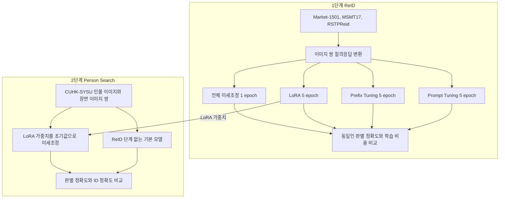

[한국어](./vlm-person-reid-thesis.md) | [English](./vlm-person-reid-thesis.en.md)

# 7B 시각-언어 모델을 미세조정해 동일인 판별 정확도 97.05%(Market-1501)를 얻고, 2단계 전이로 Person Search ID 정확도를 71.76%에서 78.57%로 높였습니다

> 두 이미지 속 인물이 같은 사람인지와 ID를 답하도록 LLaVA-Interleave-Qwen-7B를 미세조정하고, 제한된 GPU에서 전체 미세조정과 PEFT 3종을 총 학습 시간을 맞춰 비교한 뒤, ReID 단계의 LoRA 가중치를 Person Search 학습의 초기값으로 이어 쓴 개인 연구입니다.

## 개요

| 항목 | 내용 |
| --- | --- |
| 기간 | 2025.03 ~ 2025.05 |
| 형태 | 개인 연구. Fudan University 학부 졸업논문 '멀티모달 대형 모델 기반 행인 인식 연구' |
| 팀과 내 역할 | 1인 연구, 기여도 100%. 같은 연구를 정리한 학술대회 논문 2편의 제1저자 |
| 기술 | LLaVA-Interleave-Qwen-7B, PyTorch, Hugging Face Transformers, PEFT(LoRA, Prefix Tuning, Prompt Tuning), DeepSpeed, Alibaba Cloud GPU. 학습 스크립트는 공개 프레임워크 lmms-finetune을 fork해 사용 |
| 대표 결과 | 동일인 판별 정확도 97.05%(Market-1501, 전체 미세조정). 2단계 전이로 Person Search 판별 정확도 87.47%에서 92.86%, ID 정확도 71.76%에서 78.57%(CUHK-SYSU, 기본 모델 대비). 제1저자 학술대회 논문 2편(둘 다 게재 확정) |

## 문제

행인 재식별(ReID)은 카메라, 시간, 장소가 달라도 같은 사람을 찾아내는 기술로, 지능형 영상 감시에 쓰입니다. 이미지 특징만 비교하는 기존 방식은 조명, 자세, 시점, 가림 변화에 약합니다. 시각-언어 모델(VLM)이 이 과제에 쓰일 수 있는지는 실험으로 확인해야 했습니다.

문제는 학습 비용이었습니다. 7B 모델 전체를 학습하면 epoch당 2~3시간이 걸리는 제한된 GPU 환경이었고, 전체 미세조정은 사전학습 지식을 잊을 위험도 있습니다. 그래서 질문을 둘로 잡았습니다. VLM으로 행인 재식별이 가능한지, 그리고 연산 자원이 제한된 곳에서는 어떤 미세조정 방식을 골라야 하는지입니다.

## 내가 한 일과 판단



### 1. 재식별을 이미지 쌍 질의응답으로 바꿔, 모델이 같은 사람인지와 ID를 직접 답하게 했습니다

LLaVA-Interleave-Qwen-7B는 한 입력에 이미지 여러 장을 섞어 받을 수 있지만, 사전학습에서 두 이미지의 인물을 비교하는 과제를 본 적은 없었습니다. 그래서 Market-1501, MSMT17, RSTPReid, CUHK-SYSU를 두 이미지 속 인물의 동일 여부와 ID를 답하는 질의응답 데이터로 변환했습니다. ReID 데이터에서는 같은 ID의 이미지로 양성 쌍을, 서로 다른 ID에서 무작위로 고른 이미지로 같은 수의 음성 쌍을 만들었습니다. RSTPReid는 인물 설명 문장을 함께 쓰는 조건과 쓰지 않는 조건으로 나눴습니다.

공개 fork에 남아 있는 2025년 4월 말의 MSMT17 변환 예시는 다음 형식입니다.

```text
질문: <image> Are these two people the same?<image> Also, guess the person-ID of each image.
답:   no, id1: 178, id2: 864
```

이렇게 바꾸면 평가가 까다로워집니다. 생성 모델은 같은지 다른지를 답하지 않을 수도 있습니다. 평가 지표에 응답률을 두고, 판별 정확도를 평가 쌍 전체 기준과 응답한 쌍 기준으로 따로 집계했습니다. 정밀도, 재현율, F1도 함께 쟀고, ID 정확도는 Person Search에서 쟀습니다.

### 2. 전체 미세조정을 성능 상한 기준선으로 두고, PEFT 3종을 총 학습 시간을 맞춰 비교했습니다

가장 높은 정확도 하나만 좇기보다 성능과 비용의 균형점을 찾는 비교로 설계했습니다. 전체 미세조정을 기준선으로 두고 LoRA(rank 8), Prefix Tuning(길이 32, 96), Prompt Tuning을 비교했습니다. LoRA는 언어 모델과 이미지 인코더 양쪽에 적용했습니다.

예비 실험에서 전체 미세조정은 PEFT보다 학습 시간이 약 5배 길었습니다. 그래서 epoch 수 대신 총 학습 시간을 맞춰 전체 미세조정은 1 epoch, PEFT는 5 epoch로 정했습니다. 스케줄러(cosine), warmup 비율(0.03), 혼합 정밀도 설정은 네 방식에 같게 두었고, 학습률은 방식마다 따로 정했습니다. 이 선택으로 전체 미세조정은 학습 데이터를 한 번만 보게 되었습니다.

### 3. 겹쳐 나온 학습 오류 세 가지를 가장 작은 재현 단위로 나눠 차례로 해결했습니다

제한된 GPU로 7B 모델을 학습시키는 과정에서 멀티 GPU 설정 오류, 이미지 토큰 수 불일치, DeepSpeed의 sparse attention 충돌이 겹쳐 나와 어느 것이 원인인지 구분하기 어려웠습니다. 한꺼번에 해결하려던 방식을 버리고, 로그를 처음부터 읽어 오류를 하나씩 분리했습니다. 각 오류가 다시 나타나는 가장 작은 실행 단위를 만들어 그 안에서 원인을 확인한 뒤 고쳤고, 세 문제를 차례로 해결한 뒤에야 학습을 끝까지 돌릴 수 있었습니다.

공개 fork에는 이 시기에 이미지 토큰 처리를 고친 커밋이 남아 있습니다. LLaVA-Interleave의 loader와 collator에서 processor의 patch_size(14)와 vision_feature_select_strategy를 직접 지정하고, collator에서 이미지 토큰 수를 직접 늘리던 코드를 주석 처리했습니다.

### 4. ReID 단계의 LoRA 가중치를 Person Search 학습의 초기값으로 이어 쓰는 2단계 전이를 설계했습니다

Person Search는 잘라낸 인물 이미지와 전체 장면 이미지를 받아, 그 인물이 장면에 있는지와 ID를 맞히는 과제입니다. CUHK-SYSU로 이 이미지 쌍을 만들고, 1단계의 PEFT 중 Market-1501과 MSMT17에서 정확도가 가장 높았던 LoRA의 가중치를 2단계 학습의 초기값으로 재사용했습니다.

1단계에서 정확도가 가장 높았던 방식은 전체 미세조정이었습니다. 그래도 연산 자원이 제한된 환경을 전제로 한 연구여서, 2단계는 학습 파라미터가 전체의 0.1% 미만인 LoRA로 진행했습니다. 전이의 효과는 ReID 단계를 거치지 않은 기본 모델과 같은 조건으로 비교해 확인했습니다.

## 결과와 검증

표 1. 1단계 ReID의 동일인 판별 정확도와 학습 비용. 정확도는 평가에 쓴 이미지 쌍 전체를 분모로 한 값이며, 모델이 판단을 내리지 않은 쌍도 분모에 들어갑니다.

| 방식 | 학습 파라미터(전체 대비) | epoch당 학습 시간 | Market-1501 | MSMT17 | RSTPReid(설명 문장 없음) |
| --- | --- | --- | --- | --- | --- |
| 전체 미세조정, 1 epoch | 약 70억(100%) | 2~3시간 | 97.05% | 96.15% | 91.75% |
| LoRA rank 8, 5 epoch | 약 470만(0.1% 미만) | 30~40분 | 82.45% | 83.76% | 42.17% |

- 전체 미세조정이 Market-1501과 MSMT17에서 네 방식 중 가장 높았고, VLM으로도 행인 재식별이 가능함을 확인했습니다.
- Market-1501과 MSMT17에서는 PEFT 중 LoRA가 가장 좋았습니다. 전체의 0.1% 미만인 파라미터만 학습하고 MSMT17에서 전체 미세조정 정확도의 약 87%(83.76% / 96.15%)를 냈고, epoch당 학습 시간은 2~3시간에서 30~40분으로 줄었습니다.
- Prefix Tuning(길이 32, 96)과 Prompt Tuning은 두 데이터셋에서 LoRA보다 판별 정확도가 낮았고, Prefix Tuning은 토큰 수에 따라 성능이 크게 흔들렸습니다.

표 2. 2단계 Person Search(CUHK-SYSU)의 기본 모델 대비 결과.

| 지표 | 기본 모델 | ReID LoRA 가중치로 시작 | 차이 |
| --- | --- | --- | --- |
| 판별 정확도(평가 쌍 전체 기준) | 87.47% | 92.86% | +5.39%p |
| ID 정확도 | 71.76% | 78.57% | +6.81%p |

표의 수치는 졸업논문 최종본의 표 3.1, 표 3.3, 표 3.4에 실린 값입니다. Market-1501과 MSMT17의 1단계 수치는 ITAM 논문에, 2단계 수치는 ChineseCSCW 논문에도 실렸습니다.

## 논문

두 논문은 이 졸업논문 연구를 정리한 것이고, 둘 다 게재가 확정됐으며 제가 제1저자입니다.

1. **Kim, H. J.**, et al. (2025). "A Study of Person Re-identification Based on Vision-Language Multimodal Large Language Model." 31st International Conference on IT Applications and Management (ITAM-31), 2025.10.26 ~ 10.30 개최, 논문집 pp. 252-259, ISSN 2334-0114.
   VLM의 ReID 적용 가능성, 미세조정 방식에 따른 성능과 학습 비용의 차이
2. **Kim, H. J.**, et al. (2025). "A Cost-Effective Training Method for Large Models in Pedestrian Search Task." 20th CCF Conference on Computer Supported Cooperative Work and Social Computing (ChineseCSCW 2025), 2025.11.07 ~ 11.09 개최.
   ReID 단계의 LoRA 가중치를 Person Search의 초기값으로 쓰는 단계별 학습 방법

## 한계

- 보고한 수치는 이미지 쌍을 두고 같은 사람인지 답하는 판별 정확도입니다. 갤러리 전체에서 후보를 순위로 매기는 표준 ReID 검색 지표(mAP, Rank-1)는 졸업논문에 없어, 기존 ReID 방법의 공개 수치와 직접 비교할 수 없습니다.
- 설명 문장을 쓰지 않은 RSTPReid에서 LoRA는 판별 정확도가 42.17%에 그쳤고, '같은 사람' 쪽 정밀도, 재현율, F1이 0%였습니다. 논문에서 원인을 분석하지 못했고 학습 부족이나 불균형 가능성만 적었습니다. 설명 문장을 함께 쓴 조건의 수치는 싣지 않았습니다.
- 총 학습 시간을 맞춘 비교여서 epoch 수(1과 5), 학습률, weight decay가 방식마다 다릅니다.
- 숫자로만 표현한 ID 예측의 한계를 확인했고, 2단계 뒤에도 ID 정확도는 78.57%입니다. 논문은 학습 가능한 신원 토큰과 옷 색, 소지품 같은 속성 라벨을 개선 방향으로 제시했습니다.
- 공개 fork의 스크립트 설정(4비트 양자화 옵션, 학습률)과 노트북의 쌍 생성 방식은 2025년 4월 말의 것으로, 졸업논문에 적은 최종 설정과 다릅니다. 평가 코드와 체크포인트는 공개 저장소에 없습니다.

## 확인할 자료

- [khj1212k/lmms-finetune](https://github.com/khj1212k/lmms-finetune): 졸업논문 실험 시기의 학습 스크립트 fork. 원저장소는 zjysteven/lmms-finetune이고, 제 커밋은 2025-04-29부터 2025-05-08까지 5개입니다. 커밋 메시지는 업로드 기록만 남아 있어, 바뀐 내용은 아래 두 커밋의 diff와 설명으로 확인할 수 있습니다.
- [loader 수정 커밋](https://github.com/khj1212k/lmms-finetune/commit/a4e4dc676e7ace9de80096132c0d692d400c7964)과 [collator 수정 커밋](https://github.com/khj1212k/lmms-finetune/commit/5ba914e99cf8b015df32d76d67dc38e4f50ce3fe): LLaVA-Interleave의 이미지 토큰 처리 수정(2025-04-29)
- [llava_msmt17.sh](https://github.com/khj1212k/lmms-finetune/blob/541c909e6c2a5c66872e64d9d0ae1d5aaa1191e2/llava_msmt17.sh): MSMT17 학습 실행 스크립트. LoRA rank 8, 4비트 양자화 옵션(Q_LORA), 이미지 인코더 LoRA, DeepSpeed ZeRO-2, GPU 2개 설정(NUM_GPUS=2)
- [데이터 변환 커밋](https://github.com/khj1212k/lmms-finetune/commit/997a7ab60165abc1ee4368e8324214aecd643f29): MSMT17을 이미지 쌍 질의응답으로 바꾸는 초기 노트북(ID마다 음성 1쌍)과 변환 결과 파일 msmt17_train_full_55.jsonl(양성과 음성 1,041쌍씩). 이미지 경로와 문답만 있고 이미지는 없습니다.
- 데이터셋의 인물 이미지는 데이터셋 이용 조건 때문에 싣지 않습니다.
- 두 논문의 전문과 졸업논문 본문(중국어)은 이 저장소에 싣지 않고, 논문은 서지 정보만 적습니다.
